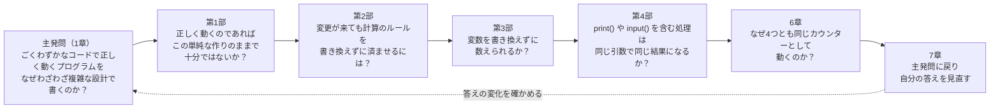

# 発問の手引き：本書の問いを、教える側から読み解く

> [README](README.md)（カウンター機能の設計進化とアーキテクチャ探求ログ）を読み終えた人のうち、勉強会の講師やメンターなど人に教える立場の人や、問いの作り方に関心がある人のための文書です。README で設計を学ぶうえでは、読む必要はありません。
> README では、設計を学ぶ側として問いを受けてきました。この文書では視点を移し、それらの問いを教える側がどのように考えて作ったのかを読み解きます。

**この文書の構成**

| 章 | 内容 |
| :--- | :--- |
| 1. 発問とは何か | 質問との違い、発問の種類 |
| 2. 発問の効果 | 発問が学ぶ人に何をもたらすか。README での体験と照らし合わせる |
| 3. 発問を検討するために必要なもの | 学習者の想定、教材研究、ねらい、発問の系列、予想される反応と切り返し、評価 |
| 4. 発問の言葉を吟味する | README の問いを推敲した記録 |
| 5. 発問を検討するためのチェックリスト | 発問を作ったあとに見直す観点 |
| 6. やってみよう：発問を作る | README の一節を題材にした演習 |

---

## 1. 発問とは何か

### 1.1 質問との違い
日常の「質問」は、問う側が知らないことを、知っている相手に尋ねるものです。これに対して **発問** は、教える側が答えや考えの道筋をある程度見通したうえで、学ぶ人に考えさせるために意図して投げかける問いです。

| | 質問 | 発問 |
| :--- | :--- | :--- |
| 問う人 | 答えを知らない人 | 答え、または到達させたい理解を見通している人 |
| 目的 | 情報を得る | 学ぶ人の思考を引き出し、理解へ導く |
| 例 | 「このコードは、どのフォルダで実行すればよいですか？」 | 「正しく動くのであれば、この単純な作りのままで十分ではないか？」 |

README の問いは、すべて発問として設計されています。答えを知らないから尋ねているのではなく、読者に考えてもらうために問いかけています。

### 1.2 発問の種類
発問は、いくつかの観点で分類できます。観点が異なるので、1つの発問が複数の種類にあてはまることもあります。

| 観点 | 種類 | 説明 | README での例 |
| :--- | :--- | :--- | :--- |
| 役割 | 主発問 | 学習全体を貫く中心の問い。最後にもう一度立ち返る | 1章「ごくわずかなコードで正しく動くプログラムを、なぜわざわざ複雑な設計で書くのか？」 |
| 役割 | 補助発問 | 主発問に答えるために、考える道筋を分けて示す問い | 4章の各部の冒頭の問い |
| 答えの形 | 閉じた発問 | 答えが1つに定まる。理解の確認に向く | 「試してみよう」の「表示される値を予想してください」 |
| 答えの形 | 開いた発問 | 複数の答えがありうる。考えを広げるのに向く | 第2部「…計算のルールを書き換えずに済ませるには、どう作ればよいか？」 |
| 働き | ゆさぶり発問 | 学ぶ人が当然と思っていることを揺さぶり、考え直させる | 第3部「数を数えるのに、変数を書き換えずに済ませることはできるか？」 |
| 働き | 択一発問 | 二択などで立場を決めさせ、その理由を考えさせる | 第1部「正しく動くのであれば、この単純な作りのままで十分ではないか？」（「十分」「不十分」を選ぶ） |

---

## 2. 発問の効果

### 2.1 発問が学ぶ人にもたらすもの
README を読んだときの体験と照らし合わせてみてください。

| 効果 | 内容 | README での体験 |
| :--- | :--- | :--- |
| 注意を焦点化する | 何に注目して読めばよいかが定まる | 各部の冒頭の問いが、その部で読み取るべきことを示していた |
| 既有知識を呼び起こす | 自分の知っていることと結びつけて考え始める | 第3部の問いで、「数を数えるには変数を書き換えるもの」という常識を思い出した |
| 認知的な葛藤を生む | 予想と結果のずれが、知りたいという動機になる | 第1部で、入力の列から結果を返す関数を作ろうとすると、計算のルールを写すしかなかった |
| 考えを言葉にさせる | 書き留めることで、あいまいな理解がはっきりする | 「考えてみよう」で、自分の答えを1〜2行で書いた |
| 思い込みを表面化させる | 予想が外れることで、思い込みに気づく | 第4部で、`print_io("hello")` を作った時点で表示されると予想した |
| 学習を構造化する | 主発問と補助発問のつながりが、学習全体の道筋になる | 1章の問いが4章の4つの問いを経て、6章と7章の答えにつながった |
| 自分で問う力を育てる | 問いを受け続けることで、自分で問いを立てられるようになる | 7章で、本書の問いを、自分の設計に向ける問いとして持ち帰った |

発問の効果は、問いと答えのあいだに **考える間** があって初めて生まれます。README で、問いのすぐ後に解説を置かず、「考えてみよう」「試してみよう」「コードを読んでみよう」を挟み、結果と答え合わせを折りたたんだのはそのためです。

### 2.2 振り返ってみよう
README を読んだ自分の体験を振り返ってください。
* 問いがあることで、何に注目して読んでいましたか。
* もし各部の冒頭の問いがなく、解説だけが書かれていたら、読み方はどう違ったでしょうか。
* 予想が外れた問いはどれでしたか。外れたことは、理解にどう影響しましたか。
* 最も考えさせられた問いと、あまり考えずに読み進めた問いは、何が違っていたのでしょうか。

---

## 3. 発問を検討するために必要なもの
発問は、思いついた問いを並べるだけでは働きません。次の要素を検討して、初めて意図した効果を持ちます。ここでは、README の発問を例に示します。

### 3.1 学習者の想定
誰に向けた発問なのかを決めます。学ぶ人がすでに知っていること（既有知識）と、揺さぶりたい思い込みを具体的に書き出します。

* **想定した学習者**: Python の基本文法が分かり、小さなプログラムなら書けるエンジニア。DDD、関数型プログラミング、モナドは、名前を聞いたことがある程度。
* **既有知識**: 変数の書き換え、クラス、関数、`print()` と `input()`。
* **揺さぶりたい思い込み**:
  * 動くコードが書ければ、設計は後から考えればよい
  * 設計（アーキテクチャ）は、大規模なシステムのためだけのもの
  * 数を数えるには、変数を書き換えるしかない
  * `print()` は、書いた場所ですぐに実行されるもの
  * モナドは難しい数学の話で、実務とは関係ない

### 3.2 教材研究
発問は、教材の本質をつかむことから生まれます。教材の表面（クラスの数やパターンの名前）をなぞる問いでは、学ぶ人は本質にたどり着けません。

README の教材研究の結論は、6章の「4つの実装は、どれも同じ1つの式 `count[n] = δ(count[n-1], 入力[n])` を計算しており、違うのは状態と副作用をどこに置くかだけ」というものです。各部の発問は、この結論から逆算して、「状態」と「副作用」に注目させるように作っています。

| 部 | 注目させたいこと |
| :--- | :--- |
| 第1部 | 表示・入力・計算・状態を1つのループに書くと、変更が来たときに何が起きるか |
| 第2部 | 状態と計算のルールを、変更されやすい部分（画面・保存先）から切り離すには、どうすればよいか |
| 第3部 | 状態を、書き換えずに表せるか |
| 第4部 | 副作用（画面出力・入力）を、どう扱えばよいか |

### 3.3 ねらい（到達目標）
発問ごとに、学ぶ人が何を説明できるようになればよいかを決めます。ねらいが決まっていないと、発問の良し悪しを判断できません。

| 発問 | ねらい（読み終えたときに説明できること） |
| :--- | :--- |
| 主発問（1章） | 設計の複雑さは、どんな変更に備えるかと、そのためのコストとの釣り合いで選ぶものだと説明できる |
| 第1部 | 表示・入力・計算を1つのループに書く作りは、変更の予定がなければ最も単純で良い設計だが、入出力の変更やカウンターを複数にする変更が、計算を含むループ全体に及ぶことを説明できる |
| 第2部 | 層に分け、依存の向きをビジネスルールにそろえると、画面や保存先を変えても計算のルールが変わらないことを説明できる |
| 第3部 | 状態の変化を値の列（畳み込み）として表すと、変数を書き換えずに数えられ、途中経過も再現できることを説明できる |
| 第4部 | 副作用を「後で実行する手順」として値にすると、組み立てと実行を分けられることを説明できる |
| 6章 | 4つの実装が同じ式を計算しており、違いは状態と副作用の置き場所であることを説明できる |

### 3.4 発問の系列
主発問と補助発問を、どの順に並べるかを決めます。README では、次の流れにしています。

* 第1部で、まず「このままで十分」という立場を取らせ、演習（変更依頼 R1：入力の列から結果を返す関数を書き足す）で揺さぶります。
* 第2部では、第1部で体験した「変更に耐えられない」という問題を前提に、解決の方法を問います。「試してみよう」では第1部と同じ課題（`count_from`）を使い、2つの実装を見比べさせます。
* 第3部と第4部では、「状態」と「副作用」という観点を、1つずつ取り出して問います。
* 6章でそれらを1つの式にまとめ、7章で主発問に戻って、自分の答えの変化を確かめさせます。
* 最後に、本書の問いを、実際の開発で自分の設計に向ける問いとして持ち帰らせます。学んだことを、教材の外へ転移させるためです。

### 3.5 予想される反応と切り返し
発問に対して学ぶ人がしそうな答えを、複数想定しておきます。それぞれに対して、考えをさらに進めるための次の問い（**切り返し**）を用意します。

| 発問 | 予想される反応 | 切り返し |
| :--- | :--- | :--- |
| 第1部 | 「十分。正しく動いているのだから」 | 「Web から使うために、入力の列から結果を返す関数が必要になったら？」（「試してみよう」で確かめさせる） |
| 第1部 | 「不十分。大規模になると困るから」 | 「このカウンターが大規模になることはあるか。どんな変更が来たら困るのか？」 |
| 第2部 | 「クラスに分ければよい」 | 「クラスに分けても、計算のクラスが画面や保存先のクラスを import していたら、どうなるか？」（5.1 ④の依存の向き） |
| 第3部 | 「できない。数えるには変数を書き換えるしかない」 | 「途中経過の列 `[0, 1, 2, 50, 51]` を、入力の列から一度に作ることはできないか？」 |
| 第3部 | 「できるが、得られるものはない」 | 「同じ入力を2回与えたとき、`simple.py` と `counter_stream` で、手間はどう違うか？」 |
| 第4部 | 「同じ結果になる」 | 「`input()` を2回呼んだら、同じ文字列が返ってくるか？」 |
| 第4部 | 「ならない。だから関数型では扱えない」 | 「実行そのものではなく、『実行する手順』を値として持つことはできないか？」 |
| 6章 | 「どれも Python で書いているから」 | 「4つに共通して書かれている規則は何か。4章の対応表で、F2〜F5 がどこに書かれているかを比べてみよう」 |

文書では、切り返しをその場で投げかけることはできません。そのため README では、主な切り返しを「考えてみよう」や、折りたたんだ「結果」「答え合わせ」の中に書いています。

### 3.6 評価
ねらいに届いたかどうかを、どう確かめるかを決めます。

| 発問 | 確かめ方 |
| :--- | :--- |
| 第1部 | `simple.py` で入力の受け取り方を変えると、なぜ計算のコードまで変更範囲に入り、同じ計算のルールが複数の場所に書かれることになるのかを、説明できるか |
| 第2部 | `count_from` を既存のファイルを書き換えずに書けた理由を、計算のルールの置き場所と依存の向きから説明できるか。保存先を変えるときに書き換えるファイルを、依存の向きの図から挙げられるか |
| 第3部 | `counter_stream` に同じ入力を与えると、なぜ何度でも同じ列が得られるのかを説明できるか |
| 第4部 | `print_io("hello")` を作っただけでは表示されず、`unsafe_run_sync()` で表示される理由を説明できるか |
| 6章 | 4章の対応表の F4 の行を見て、「上限」という仕様の追加が各実装のどこに入ったかを説明できるか |
| 主発問 | 7章で書いた答えに、「どんな変更に備えるか」と「そのコスト」の両方が含まれているか |

---

## 4. 発問の言葉を吟味する
同じ内容を問うても、言葉の選び方によって発問の働きは大きく変わります。README の問いは、次のように推敲してきました。

### 4.1 主発問：あいまいな語と、距離を生む主語を取り除く

| 版 | 発問 |
| :--- | :--- |
| 当初 | 20行で完璧に動くのに、なぜプロはわざわざ難しく書くのか？ |
| 現在 | ごくわずかなコードで正しく動くプログラムを、なぜわざわざ複雑な設計で書くのか？ |

* **「20行」**: 具体的な数字は事実の主張として読まれ、実際の行数と食い違います。伝えたいのは、ごくわずかであることです。
* **「完璧に」**: 誇張です。「正しく動く」で十分であり、正しさは契約テストで確かめられます。
* **「プロは」**: 「プロならそうする」という前提を問いに含めてしまいます。読者は「自分はプロではない」と距離を置けてしまうため、主語を外して読者自身の問いにしました。
* **「難しく」**: 何が難しいのかがあいまいです。「複雑な設計」として、問う対象を設計に限定しました。
* **残した前提**: 「わざわざ…書くのか」は、「実際に複雑な設計が使われている」という事実を前提にしたゆさぶりです。前提にしているのは読者も知っている事実であり、到達させたい結論ではありません。そのため、考える余地を奪いません（4.3 と比べてください）。

### 4.2 第2部：問いの前提と教材を、一緒に直す

| 版 | 発問 |
| :--- | :--- |
| 当初 | 画面を変更しただけで、なぜ計算ロジックが壊れることがあるのか？ |
| 修正1 | カウンターを2つ動かす、保存先をデータベースに変える。こうした変更が来ても、計算のルールを書き換えずに済ませるには、どう作ればよいか？ |
| 修正2（現在） | 画面を変える、カウンターを2つ動かす、保存先をデータベースに変える。こうした変更が来ても、計算のルールを書き換えずに済ませるには、どう作ればよいか？ |

当初の問いは、「画面を変えると計算が壊れる」ことを前提にしていました。しかし当時の教材の `simple.py` は、入出力（`run_simple_counter`）と計算（`process`）を別の関数に分けており、画面を変えても計算は壊れませんでした。読者は、問いの前提を教材で確かめることができませんでした。

問いと教材が食い違ったとき、直し方は2つあります。

* **問いを教材に合わせる**（修正1）: 当時の教材で確かめられた問題（カウンターを2つ動かせない）を前提にした問いに書き換えました。あわせて、到達させたい結論を前提にしない、開いた問いの形にしています。
* **教材を問いに合わせる**（修正2）: 第1部で体験させたいのは、「入出力を変えるだけで、計算まで変更範囲に入る」ことでした。そこで `simple.py` を、`process` を分けずに、表示・入力・計算を1つのループに書く作りに改めました。画面（入出力）の変更が計算に及ぶことを第1部の「試してみよう」で確かめられるようになったため、問いに「画面を変える」を戻しました。

**発問の前提は、学ぶ人が体験したこと、または教材で確かめられることに置く** 必要があります。発問と教材は別々に作るものではなく、体験させたいことに合わせて一緒に設計するものです。

### 4.3 第3部・第4部：到達させたい結論を、問いの前提にしない

| 部 | 修正前 | 修正後 |
| :--- | :--- | :--- |
| 第3部 | 数を数えるのに、なぜ変数を書き換えない方がよいのか？ | 数を数えるのに、変数を書き換えずに済ませることはできるか？ できるとしたら、何が得られるか？ |
| 第4部 | 画面出力やキーボード入力は、なぜ特別に扱う必要があるのか？ | `print()` や `input()` を含む処理は、同じ引数で呼べば必ず同じ結果になるか？ ならないとしたら、どう扱えばよいか？ |

修正前の問いは、「書き換えない方がよい」「特別に扱う必要がある」という、その部で到達させたい結論そのものを前提にしていました。「なぜ」と問われると、読者は前提を受け入れたうえで理由を探すことになり、「本当にそうか」と考える余地がなくなります。

修正後は、まず答えが分かれる問い（できるか／同じ結果になるか）で予想させ、そのあとに「何が得られるか」「どう扱えばよいか」と考えを進める、2段の問いにしました。

### 4.4 第1部：問う対象を表す語をそろえる

| 版 | 発問 |
| :--- | :--- |
| 修正前 | 動くのであれば、設計は不要ではないか？ |
| 修正後 | 正しく動くのであれば、この単純な作りのままで十分ではないか？ |

修正前の問いは、「設計」が何を指すのかがあいまいでした。`simple.py` も「素朴な手続き型設計」という1つの設計であり、README の解説も「最も単純な設計です」と書いています。そのため「設計は不要か」と問うと、問いと解説が食い違ってしまいます。

修正後は、問う対象を「この単純な作り」に限定し、主発問の「正しく動く」「複雑な設計」と言葉をそろえました。択一の選択肢も、「不要／必要」から「十分／不十分」に変えています。

### 4.5 問いより前に、答えを見せない
発問の言葉だけを整えても、問いより前に答えが書かれていれば、考える間は生まれません。README には、問いの前に答えが見えてしまう箇所が、次のようにいくつもありました。

| 箇所 | 問題 | 修正 |
| :--- | :--- | :--- |
| 1章の「4つの実装の概要」 | 各部の説明が、その部の問いの答えになっていた（例：第4部「副作用まで、値として扱います」） | 「何を解決したか」ではなく「どう書いたか」の説明にした |
| 4章の各部の冒頭 | 問いより前に「設計思想」「位置づけ」があり、答えが先に見えていた | 問いを見出しの直後に置き、「設計思想」「位置づけ」は解説の冒頭へ移した |
| 2章の表 | 「`IO` モナド（副作用の遅延実行）」のような説明書きが、第4部の問いの答えになっていた | 説明書きを外し、手法の名前だけにした |
| 目次と6章 | 目次に「4実装が同じ1つの式を計算していること」とあり、6章でも問いの直後に答えがあった。答えを折りたたんでも、そのすぐ下の見出し（「6.1 4つの実装が共有する1つの式」）で答えが見えていた | 目次は問いの形にし、6章の答えは折りたたみ、答えを含む見出しも言い換えた |
| 本書の読み方 | 「5章を先に読んでください」と案内していたが、5章には各部の問いの答えが書かれていた | 問いに答えてから5章を参照するよう案内を変えた |
| 実装のコード | いつ開けばよいかを示していなかった。先に開くと、コードのコメントや構造から答えが見えてしまう | 「試してみよう」の直後に「コードを読んでみよう」を置き、開くタイミングと、コードの中で探す問いを示した（4.6） |

発問は、問いの文言だけでなく、**問いより前に何を見せるか**、そして **教材の実物（ここではコード）にいつ触れさせるか** まで含めて検討する必要があります。

### 4.6 活動の順序：答えを、それを探させる活動より前に書かない
「コードを読んでみよう」を最初に加えたとき、README には次の食い違いがありました。

* 「試してみよう」の結果の説明（折りたたみ）で、すでに仕組みを説明していた（例：第4部「作られるのは『hello を表示する』という手順を表す値で、`unsafe_run_sync()` を呼んだときに初めて実行されます」）。
* その後の「コードを読んでみよう」で、「実際に副作用が起きるのはどこか」と、すでに説明した答えを探させていた。

答えを読んだ後に「探してみよう」と問われても、探す意味がありません。そこで、各部の活動を次の順にそろえました。

| 順 | 活動 | 学ぶ人がすること |
| :--- | :--- | :--- |
| 1 | 問い・考えてみよう | 自分の答えや予想を書き留める |
| 2 | 試してみよう | 実行したり書き換えたりして、結果を見る。結果は見せるが、理由は説明しない（「なぜそうなったのか」という次の問いだけを示す） |
| 3 | コードを読んでみよう | 結果の原因を、コードの中で自分で探す |
| 4 | 答え合わせ | 探した答えを確かめる。仕組みの説明はここで初めて行う |
| 5 | 解説、強みと代償 | 全体像をまとめる |

1つの活動の結果が、次の活動の問いになるように並べると、学ぶ人は自分で考え続けることができます。

### 4.7 前提は見せ、答えは隠す
4.5 と 4.6 では、答えを問いより前に見せないように直しました。しかし、隠しすぎると別の問題が起きます。

第1部の問い「正しく動くのであれば、この単純な作りのままで十分ではないか？」は、`simple.py` の作りそのものについて尋ねています。それなのに、「コードは『コードを読んでみよう』で初めて開く」という決まりのために、読者は問いの時点で「この単純な作り」を見ていませんでした。問いが指す対象を知らないまま、答えを選ぶことになっていたのです。

| 問いの要素 | 問いより前に | 理由 |
| :--- | :--- | :--- |
| 前提（問いが指す対象） | 見せる | 対象を把握していなければ、問いに答えられない |
| 答え（到達させたい理解） | 見せない | 先に見えると、考える間がなくなる |

そこで第1部では、問いの前に `simple.py` の全文を示しました。ただ、コードが見えていると、「計算だけを呼び出せる関数はあるか」という予想は簡単すぎて、揺さぶりになりません。そのため「試してみよう」も、入力の列から結果を返す関数を実際に書き足し、元のコードの何行を写すことになるかを予想させる活動に改めました。

### 4.8 活動で何を予想するのかを、はっきりさせる
第2部の「試してみよう」は、当初、`oop/` でカウンターを2つ動かすコードを示し、「表示される2つの値を予想してください」と問うものでした。しかし、次の理由で、読者には何を期待されているのかが想像しにくい活動になっていました。

* まだ説明していない部品の名前（コンテナ、Mediator、プロジェクション、各コマンド）が並び、コードが何をしているのかを読み取れなかった。
* 予想させる値はコメントから明らかで（`5 1`）、考える余地がなかった。
* 問い（計算のルールを書き換えずに済ませるには）と、予想させること（2つの値）が結びついていなかった。

そこで、第1部と同じ課題（入力の列から最後の値を返す `count_from`）を `oop/` で書いたコードに差し替え、第1部で自分が書いたものと見比べさせました。予想させることも、問いに直結する「計算のルールはどこにあるか」「既存のファイルを何行書き換えたか」にしています。コードには部品の役割を平易な言葉でコメントし、「中身はまだ知らなくてよい」と添えました。

前の活動と同じ課題を使うと、学ぶ人は何と比べればよいかが分かり、違いに注目できます。

### 4.9 活動で使う変更を、仕様として定義する
README の1章では、外部仕様を機能 F1〜F6（対話型のカウンター）として定義しています。ところが第1部・第2部の「試してみよう」では、仕様にない `count_from(inputs)` を、仕様の変更であることを示さないまま、いきなり使っていました。さらに、第2部の作例は、F4（上限を超える入力の無視）を満たしていませんでした。

学ぶ人から見ると、定義された仕様と違うものを、説明なく扱わされることになります。そこで次のように直しました。

* 1章に「想定する変更依頼」として、R1（入力の列から結果を返す）、R2（カウンターを2つ動かす）、R3（保存先をデータベースに変える）を、機能と同じ形式で定義した。第2部の問いに並ぶ3つの変更は、R1〜R3 に対応する。
* 「試してみよう」では、「1章の変更依頼 R1 が来たとします」と、仕様の変更であることを明示した。
* 第2部の作例を、R1 が求めるとおり、F2〜F5 と同じルールで動くように直した。README の2つの作例が R1 を満たすことは、テストで確かめている。

演習で仕様を変えるときは、それが **変更であること** を明示し、元の仕様と **同じ形式で定義** します。そうすることで、学ぶ人は「何が変わったのか」を、仕様と照らし合わせて理解できます。

---

## 5. 発問を検討するためのチェックリスト
発問を作ったら、次の観点で見直します。

- [ ] **ねらい**: この発問で、学ぶ人が何を説明できるようになればよいかが決まっているか
- [ ] **学習者**: 学ぶ人の既有知識と、揺さぶりたい思い込みを想定しているか
- [ ] **教材研究**: 教材の本質から逆算した問いになっているか（表面をなぞる問いになっていないか）
- [ ] **前提**: 問いの前提は、学ぶ人が体験したこと、または教材で確かめられることか
- [ ] **対象の提示**: 問いが指す対象（コード・図・場面など）を、学ぶ人が問いの時点で把握できるか
- [ ] **結論の先取り**: 到達させたい結論を、問いの前提に含めていないか
- [ ] **言葉**: あいまいな語、誇張、距離を生む主語（「プロは」など）がないか
- [ ] **答えの形**: 閉じた発問か開いた発問か。ねらいに合っているか
- [ ] **予想される反応**: 学ぶ人の答えを複数想定し、それぞれへの切り返しを用意しているか
- [ ] **系列**: 主発問と補助発問がつながっており、最後に主発問へ戻れるか
- [ ] **間**: 答えや解説に進む前に、考える時間（予想・書き留め）を取れるようになっているか
- [ ] **答えの先出し**: 問いより前（目次・概要・見出し・図表・前置き）に、答えを書いていないか
- [ ] **教材に触れるタイミング**: 実物（コードなど）にいつ触れ、何に注目させるかを示しているか
- [ ] **活動の順序**: 答えや仕組みの説明が、それを探させる活動より前に書かれていないか
- [ ] **活動の見通し**: 学ぶ人が、活動で何を予想し、何と比べればよいかを想像できるか
- [ ] **仕様との整合**: 活動で扱う機能や変更が、定義した仕様（または変更依頼）として示されているか。作例はその仕様を満たしているか
- [ ] **評価**: ねらいに届いたかを確かめる方法があるか

---

## 6. やってみよう：発問を作る
README の 5章 5.2 ③「`map` と `flat_map` の違い」には、まだ発問がありません。この節のために、主発問を1つと、補助発問を2つ作ってみてください。

1. ねらいを1文で書く。
2. 学ぶ人のありがちな思い込みを1つ挙げる。
3. その思い込みを揺さぶる主発問を書く。
4. 主発問に答えるための補助発問を2つ書く。
5. 予想される反応を2つ挙げ、それぞれへの切り返しを書く。
6. 5章のチェックリストで見直す。

作例（自分で作ってから開いてください）

* **ねらい**: 途中で流れを止められるのは `flat_map` だけであり、その理由は「渡す関数が新しい箱を返すから」だと説明できる。
* **ありがちな思い込み**: 「`map` と `flat_map` は、書き方が違うだけで同じことができる」
* **主発問**: 「`Some(5)` に、`Nothing` を返す関数を `map` で適用すると、結果は `Nothing` になるか？」
  * 答えが分かれる閉じた発問です。実際の結果は `Some(Nothing())` で、多くの人の予想を外します。
* **補助発問1**: 「では、同じ関数を `flat_map` で適用すると、結果はどうなるか？」（結果は `Nothing()`）
* **補助発問2**: 「2つの結果の違いは、どこから生まれたのか？」（`flat_map` = `map` + `flatten` へ導く）
* **予想される反応と切り返し**:
  * 「`Nothing` になる」→「実際に実行して確かめてみよう。なぜ `Some` が残ったのか？」
  * 「`map` ではエラーになる」→「エラーにはならない。では、何が返ってくるか？」

