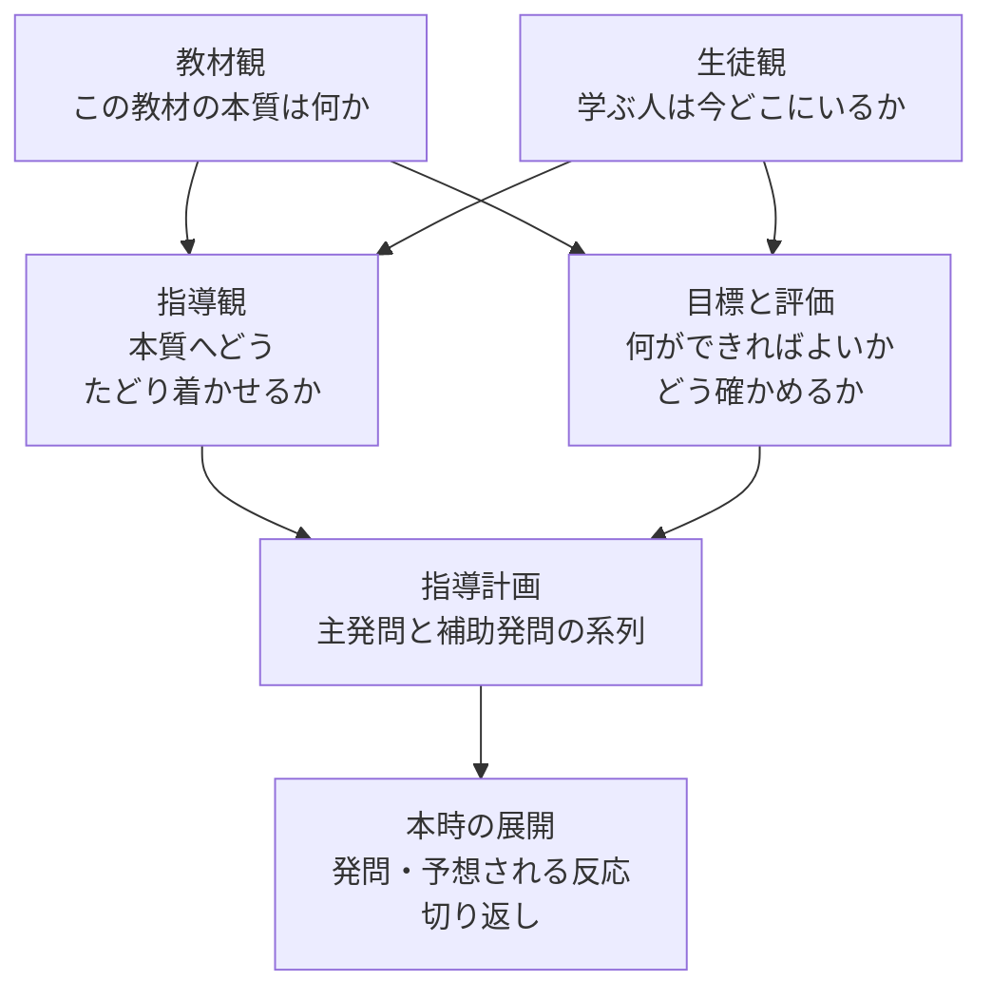
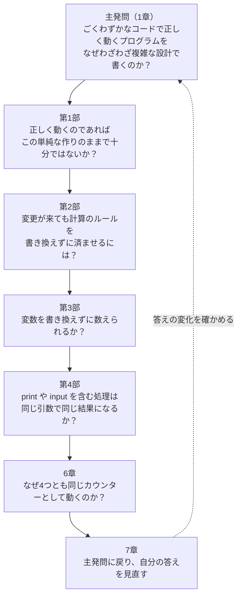

# 発問の手引き：発問を中心に指導案をつくる

> [README](README.md)（カウンター機能の設計）を読み終えた人のうち、勉強会の講師やメンターなど人に教える立場の人や、問いの作り方に関心がある人のための文書です。README で設計を学ぶうえでは、読む必要はありません。
> 発問は、ソフトウェア設計に限らず、教科の授業、研修、勉強会など、どのテーマの学習でも使えるものです。この文書は、発問を中心に **指導案**（授業の設計図）をつくるための指針です。各項目の書き方は、README で受けた問いを記入例として示します。

**この文書の構成**

| 章 | 内容 |
| :--- | :--- |
| 1. 発問とは何か | 質問との違い、発問の種類 |
| 2. 発問の効果 | 発問が学ぶ人に何をもたらすか。README での体験と照らし合わせる |
| 3. 指導案の全体像 | 指導案の項目と、それを書く順序 |
| 4. 単元について：教材観・生徒観・指導観 | 何を、誰に、どのように教えるのか |
| 5. 目標と評価 | 学ぶ人が何をできるようになればよいか。それをどう確かめるか |
| 6. 指導計画と本時の展開 | 発問の系列、1回分の学習の流れ、予想される反応と切り返し、問いの前後に置くもの |
| 7. まとめ：指導案で押さえること | 3〜6章の内容を、指導案の項目ごとにまとめる。実際の授業でどう活きるか |
| 8. やってみよう：指導案をつくる | 身近な題材（変数の名前の付け方）での演習と、自分が教えるテーマへの応用 |

---

## 1. 発問とは何か

### 1.1 質問との違い
日常の「質問」は、問う側が知らないことを、知っている相手に尋ねるものです。これに対して **発問** は、教える側が答えや考えの道筋をある程度見通したうえで、学ぶ人に考えさせるために意図して投げかける問いです。

| | 質問 | 発問 |
| :--- | :--- | :--- |
| 問う人 | 答えを知らない人 | 答え、または到達させたい理解を見通している人 |
| 目的 | 情報を得る | 学ぶ人の思考を引き出し、理解へ導く |
| 例 | 「このコードは、どのフォルダで実行すればよいですか？」 | 「正しく動くのであれば、この単純な作りのままで十分ではないか？」 |

README の問いは、すべて発問として設計されています。答えを知らないから尋ねているのではなく、読者に考えてもらうために問いかけています。

### 1.2 発問の種類
発問は、いくつかの観点で分類できます。観点が異なるので、1つの発問が複数の種類にあてはまることもあります。

| 観点 | 種類 | 説明 | README での例 |
| :--- | :--- | :--- | :--- |
| 役割 | 主発問 | 学習全体を貫く中心の問い。最後にもう一度立ち返る | 1章「ごくわずかなコードで正しく動くプログラムを、なぜわざわざ複雑な設計で書くのか？」 |
| 役割 | 補助発問 | 主発問に答えるために、考える道筋を分けて示す問い | 4章の各部の冒頭の問い |
| 答えの形 | 閉じた発問 | 答えが1つに定まる。理解の確認に向く | 第3部の「試してみよう」「2回の `print` の結果を予想してください」 |
| 答えの形 | 開いた発問 | 複数の答えがありうる。考えを広げるのに向く | 第2部「…計算のルールを書き換えずに済ませるには、どう作ればよいか？」 |
| 働き | ゆさぶり発問 | 学ぶ人が当然と思っていることを揺さぶり、考え直させる | 第3部「数を数えるのに、変数を書き換えずに済ませることはできるか？」 |
| 働き | 択一発問 | 二択などで立場を決めさせ、その理由を考えさせる | 第1部「正しく動くのであれば、この単純な作りのままで十分ではないか？」（「十分」「不十分」を選ぶ） |

---

## 2. 発問の効果

### 2.1 発問が学ぶ人にもたらすもの
README を読んだときの体験と照らし合わせてみてください。

| 効果 | 内容 | README での体験 |
| :--- | :--- | :--- |
| 注意を焦点化する | 何に注目して見たり読んだりすればよいかが定まる | 各部の冒頭の問いが、その部で読み取るべきことを示していた |
| 既有知識を呼び起こす | 自分の知っていることと結びつけて考え始める | 第3部の問いで、「数を数えるには変数を書き換えるもの」という常識を思い出した |
| 認知的な葛藤を生む | 予想と結果のずれが、知りたいという動機になる | 第1部で、入力の列から結果を返す関数を作ろうとすると、計算のルールを写すしかなかった |
| 考えを言葉にさせる | 書き留めたり話したりすることで、あいまいな理解がはっきりする | 「考えてみよう」で、自分の答えを1〜2行で書いた |
| 思い込みを表面化させる | 予想が外れることで、思い込みに気づく | 第4部で、`print_io("hello")` を作った時点で表示されると予想した |
| 学習を構造化する | 主発問と補助発問のつながりが、学習全体の道筋になる | 1章の問いが4章の4つの問いを経て、6章と7章の答えにつながった |
| 自分で問う力を育てる | 問いを受け続けることで、自分で問いを立てられるようになる | 7章で、本書の問いを、自分の設計に向ける問いとして持ち帰った |

発問の効果は、問いと答えのあいだに **考える間** があって初めて生まれます。問いのすぐ後に答えや説明を示すと、学ぶ人は考える前に答えを受け取ってしまいます。README で、問いのすぐ後に解説を置かず、「考えてみよう」「試してみよう」「コードを読んでみよう」を挟み、結果と答え合わせを折りたたんだのはそのためです。

### 2.2 振り返ってみよう
README を読んだ自分の体験を振り返ってください。
* 問いがあることで、何に注目して読んでいましたか。
* もし各部の冒頭の問いがなく、解説だけが書かれていたら、読み方はどう違ったでしょうか。
* 予想が外れた問いはどれでしたか。外れたことは、理解にどう影響しましたか。
* 最も考えさせられた問いと、あまり考えずに読み進めた問いは、何が違っていたのでしょうか。

---

## 3. 指導案の全体像
発問は、思いついた問いを並べるだけでは働きません。何を、誰に、なぜ、どのように教えるのかを検討して、初めて意図した効果を持ちます。その検討を書き表したものが **指導案** です。

### 3.1 指導案の項目
指導案の書式は、学校や組織によって異なりますが、多くは次の項目を持ちます。

| 項目 | 書くこと | 発問との関係 |
| :--- | :--- | :--- |
| 単元名 | 学習のまとまりの名前 | — |
| 単元について | **教材観**：この教材で何を学べるのか<br/>**生徒観**：学ぶ人は今どこにいるのか<br/>**指導観**：教材観と生徒観を踏まえて、どのように教えるのか | 発問を作る根拠になる |
| 単元の目標 | 単元を終えたときに、学ぶ人ができるようになること | 主発問のねらいになる |
| 評価規準 | 目標に届いたかを判断するよりどころ | 発問への反応や、活動の成果で確かめる |
| 指導計画 | 単元全体を、どの順に、何回で扱うか | 主発問と補助発問の系列になる |
| 本時の展開 | 1回分の学習の流れ（導入・展開・まとめ） | 主な発問、予想される反応、切り返し、評価を時系列に並べる |

「生徒観」は、学ぶ人に応じて「児童観」「学習者観」「受講者観」とも呼びます。この文書では「生徒観」と書きます。

### 3.2 書く順序
各項目は、上から順に思いつくものではありません。次の順に検討すると、発問に根拠を持たせることができます。



* 教材観と生徒観は、それぞれ独立に書けます。教材観は教材を、生徒観は学ぶ人を見て書きます。
* 指導観は、その2つのあいだを埋めるものです。「この教材の本質（教材観）に、学ぶ人の今（生徒観）から、どうたどり着かせるか」を書きます。
* 目標も、教材観と生徒観の両方から決まります。教材の本質のうち、この学習者が今回の学習で届くところを目標にします。
* 発問は、指導観を具体的な問いの形にしたものです。指導観が書けていないと、発問の良し悪しを判断できません。

---

## 4. 単元について：教材観・生徒観・指導観

### 4.1 教材観
教材観には、この教材で何を学べるのか、なぜそれを学ぶ価値があるのかを書きます。そのためには、教材の本質をつかむこと（**教材研究**）が必要です。教材の表面（用語や手順、結果の暗記）をなぞる問いでは、学ぶ人は本質にたどり着けません。

**書く観点**
* この教材の本質は何か。教材の表面と本質を区別できているか。
* なぜこの教材を使うのか。ほかの教材ではなく、この教材だから学べることは何か。
* 学んだことは、教材の外のどんな場面で役立つのか。

**README での記入例**

> 本書の教材は、同じ仕様のカウンターを4つの設計で実装したコードである。カウンターは数を数えるだけの小さな機能で、仕様を一読で理解できる。そのため、学ぶ人は仕様の理解に力を使わず、設計の違いだけに注目できる。
> 4つの実装は、どれも同じ1つの式 `count[n] = δ(count[n-1], 入力[n])` を計算しており、違うのは状態と副作用をどこに置くかだけである（README 6章）。クラスの数や設計パターンの名前は教材の表面であり、本質は状態と副作用の置き場所にある。
> この教材を通して、設計の選び方は「どんな変更に備えるか」と「そのためのコスト」の釣り合いで決まることを学べる。これは、規模の大きなシステムの設計にもそのまま通じる。

### 4.2 生徒観
生徒観には、学ぶ人が今どこにいるのかを書きます。足りないところだけでなく、すでに持っている力や関心も書きます。発問は、学ぶ人がすでに持っているものを手がかりにし、思い込みを揺さぶるように作るからです。

**書く観点**
* 既有知識：この学習に使える、すでに知っていること・できること。
* 経験と関心：学ぶ人が身近に感じている場面や、関心を持っていること。
* 思い込み：学ぶ人が当然と思っていて、学習で揺さぶりたいこと。
* つまずき：学習の途中で、つまずきやすいところ。

実際の授業では、事前の調査や、それまでの学習の様子をもとに書きます。文書のように学ぶ人と直接会えない場合は、想定する読者を具体的に決めて書きます。

**README での記入例**

> * **想定した学習者**: Python の基本文法が分かり、小さなプログラムなら書けるエンジニア。DDD、関数型プログラミング、モナドは、名前を聞いたことがある程度。
> * **既有知識**: 変数の書き換え、クラス、関数、`print()` と `input()`。
> * **経験と関心**: 動くプログラムを書いた経験はあるが、仕様の変更に合わせて書き直した経験は少ない。設計の手法には関心があるが、何のためにあるのかは実感していない。
> * **揺さぶりたい思い込み**:
>   * 動くコードが書ければ、設計は後から考えればよい
>   * 設計（アーキテクチャ）は、大規模なシステムのためだけのもの
>   * 数を数えるには、変数を書き換えるしかない
>   * `print()` は、書いた場所ですぐに実行されるもの
>   * モナドは難しい数学の話で、実務とは関係ない
> * **つまずき**: 第2部以降は、部品の名前（コンテナ、Mediator など）が多く、全体を一度に読もうとすると何を見ればよいかが分からなくなる。

### 4.3 指導観
指導観には、教材観と生徒観を踏まえて、どのように教えるのかを書きます。発問、活動、教材の見せ方は、ここに書いた方針から決まります。

**書く観点**
* 学ぶ人のどの思い込みから揺さぶるか。何を手がかりにするか。
* 教材の本質へ、どの順にたどり着かせるか。一度に扱わず、分けて扱うものは何か。
* どんな活動で体験させるか。何を予想させ、何と比べさせるか。
* 何を問いの前に見せ、何を隠しておくか。考える間をどう確保するか。
* つまずきやすいところで、どう支えるか。

**README での記入例**

> 設計の用語や構造の説明から入らず、学ぶ人が「このままで十分」と考える立場から始める。最も単純な実装を示して「十分か」を選ばせ、変更依頼に応えさせることで、「正しく動く」ことと「変更に耐える」ことの違いを体験させる。
> 次に、同じ変更依頼を別の設計で実現したコードと見比べさせ、計算のルールの置き場所に注目させる。状態と副作用は一度に扱わず、1つずつ取り出して問う。最後に主発問に戻り、自分の答えの変化を確かめさせる。
> 各部では、「予想する → 実行する → コードを読む → 答え合わせ」の順に活動を並べ、結果と答えは折りたたんで考える間を確保する。部品の名前が多い部では、コードを開く前に読む範囲を問いで絞り、部品の役割は平易な言葉で添える。

---

## 5. 目標と評価

### 5.1 目標（ねらい）
発問ごとに、学ぶ人が何をできるようになればよいかを決めます。目標は、「理解する」ではなく「説明できる」「挙げられる」のように、外から確かめられる形で書きます。そうすることで、評価の方法も決まります。

**README での記入例**

| 発問 | 目標（読み終えたときに説明できること） |
| :--- | :--- |
| 主発問（1章） | 設計の複雑さは、どんな変更に備えるかと、そのためのコストとの釣り合いで選ぶものだと説明できる |
| 第1部 | 表示・入力・計算を1つのループに書く作りは、変更の予定がなければ最も単純で良い設計だが、入出力の変更やカウンターを複数にする変更が、計算を含むループ全体に及ぶことを説明できる |
| 第2部 | 層に分け、依存の向きをビジネスルールにそろえると、画面や保存先を変えても計算のルールが変わらないことを説明できる |
| 第3部 | 状態の変化を値の列（畳み込み）として表すと、変数を書き換えずに数えられ、途中経過も再現できることを説明できる |
| 第4部 | 副作用を「後で実行する手順」として値にすると、組み立てと実行を分けられることを説明できる |
| 6章 | 4つの実装が同じ式を計算しており、違いは状態と副作用の置き場所であることを説明できる |

### 5.2 評価
目標に届いたかどうかを、どう確かめるかを決めます。目標と対にして書きます。教材で扱った場面をそのまま再現できるかだけでなく、新しい場面に当てはめられるかを確かめると、理解の深さが分かります。

**README での記入例**

| 発問 | 確かめ方 |
| :--- | :--- |
| 第1部 | `simple.py` で入力の受け取り方を変えると、なぜ計算のコードまで変更範囲に入り、同じ計算のルールが複数の場所に書かれることになるのかを、説明できるか |
| 第2部 | `count_from` を既存のファイルを書き換えずに書けた理由を、計算のルールの置き場所と依存の向きから説明できるか。保存先を変えるときに書き換えるファイルを、依存の向きの図から挙げられるか |
| 第3部 | `counter_stream` に同じ入力を与えると、なぜ何度でも同じ列が得られるのかを説明できるか |
| 第4部 | `print_io("hello")` を作っただけでは表示されず、`unsafe_run_sync()` で表示される理由を説明できるか |
| 6章 | 4章の対応表の F4 の行を見て、「上限」という仕様の追加が各実装のどこに入ったかを説明できるか |
| 主発問 | 7章で書いた答えに、「どんな変更に備えるか」と「そのコスト」の両方が含まれているか |

---

## 6. 指導計画と本時の展開

### 6.1 指導計画（発問の系列）
単元全体で、主発問と補助発問をどの順に並べるかを決めます。並べ方は、指導観に書いた「どの順にたどり着かせるか」に従います。

**README での記入例**



* 第1部で、まず「このままで十分」という立場を取らせ、演習（変更依頼 R1：入力の列から結果を返す関数を書き足す）で揺さぶります。
* 第2部では、第1部で体験した「変更に耐えられない」という問題を前提に、解決の方法を問います。「試してみよう」では第1部と同じ課題（`count_from`）を使い、2つの実装を見比べさせます。
* 第3部と第4部では、「状態」と「副作用」という観点を、1つずつ取り出して問います。
* 6章でそれらを1つの式にまとめ、7章で主発問に戻って、自分の答えの変化を確かめさせます。
* 最後に、本書の問いを、実際の開発で自分の設計に向ける問いとして持ち帰らせます。学んだことを、教材の外へ転移させるためです。

### 6.2 本時の展開
1回分の学習の流れを、**導入・展開・まとめ** に分けて書きます。それぞれの段階に、学ぶ人の活動、教える側の主な発問、予想される反応、指導上の留意点、評価を並べます。

* **導入**：学習の対象を示し、主となる発問を投げかけて、学ぶ人に自分の立場や予想を持たせる。
* **展開**：活動を通して、予想と結果を比べさせ、その理由を探させる。
* **まとめ**：導入の発問に戻り、自分の答えがどう変わったかを確かめさせる。

**README での記入例（第1部）**

| 段階 | 学習活動と主な発問 | 予想される反応 | 指導上の留意点 | 評価 |
| :--- | :--- | :--- | :--- | :--- |
| 導入 | `simple.py` の全体を読む。<br/>発問「正しく動くのであれば、この単純な作りのままで十分ではないか？」 | 「十分。正しく動いているのだから」<br/>「不十分。大規模になると困るから」 | 問いが「この単純な作り」を指すので、問いの前にコードの全文を示す。「十分」「不十分」を選ばせ、理由を1行で書き留めさせる | |
| 展開1 | 変更依頼 R1 に応えて、`count_from` を書き足す。<br/>発問「書き始める前に、元のコードの何行くらいを書き換えたり写したりすることになるか？」 | 「数行の追加で済む」 | R1 は1章で定義した変更依頼であることを示す。結果は折りたたみ、予想してから開かせる | |
| 展開2 | `simple.py` と自分の `count_from` を見比べる。<br/>発問「計算は、何と同じ場所に書かれているか？」「上限のルールが変わったら、何か所を直すことになるか？」 | 「`input()` や `print()` と同じループの中」<br/>「2か所」 | 答え合わせは折りたたみ、コードの中で探してから開かせる | |
| まとめ | 最初に選んだ答えを見直す。<br/>発問「最初に選んだ答えは変わったか？」 | 「十分だと思っていたが、変更が来ると困ることが分かった」 | 「正しく動く」ことと「変更に耐える」ことは別の性質であることを確かめる。「変更の予定がなければ最も単純で良い」ことも併せて確かめる | 入出力の変更が、なぜ計算のコードにまで及んだのかを説明できるか |

### 6.3 予想される反応と切り返し
発問に対して学ぶ人がしそうな答えを、複数想定しておきます。それぞれに対して、考えをさらに進めるための次の問い（**切り返し**）を用意します。本時の展開に書ききれない場合は、別の表にまとめます。

**README での記入例**

| 発問 | 予想される反応 | 切り返し |
| :--- | :--- | :--- |
| 第1部 | 「十分。正しく動いているのだから」 | 「Web から使うために、入力の列から結果を返す関数が必要になったら？」（「試してみよう」で確かめさせる） |
| 第1部 | 「不十分。大規模になると困るから」 | 「このカウンターが大規模になることはあるか。どんな変更が来たら困るのか？」 |
| 第2部 | 「クラスに分ければよい」 | 「クラスに分けても、計算のクラスが画面や保存先のクラスを import していたら、どうなるか？」（5.1 ④の依存の向き） |
| 第3部 | 「できない。数えるには変数を書き換えるしかない」 | 「途中経過の列 `[0, 1, 2, 50, 51]` を、入力の列から一度に作ることはできないか？」 |
| 第3部 | 「できるが、得られるものはない」 | 「同じ入力を2回与えたとき、`simple.py` と `counter_stream` で、手間はどう違うか？」 |
| 第4部 | 「同じ結果になる」 | 「`input()` を2回呼んだら、同じ文字列が返ってくるか？」 |
| 第4部 | 「ならない。だから関数型では扱えない」 | 「実行そのものではなく、『実行する手順』を値として持つことはできないか？」 |
| 6章 | 「どれも Python で書いているから」 | 「4つに共通して書かれている規則は何か。4章の対応表で、F2〜F5 がどこに書かれているかを比べてみよう」 |

対面の授業や研修では、学ぶ人の反応を聞いて、その場で切り返せます。文書では、切り返しをその場で投げかけることはできません。そのため README では、主な切り返しを「考えてみよう」や、折りたたんだ「結果」「答え合わせ」の中に書いています。

### 6.4 問いの前後に置くもの
発問の言葉を整えるだけでなく、問いの前と後に何を置くかも検討します。本時の展開の「指導上の留意点」には、主にこれを書きます。

| 観点 | 考え方 | README での例 |
| :--- | :--- | :--- |
| 前提は見せる | 問いが指す対象を、学ぶ人が問いの時点で把握できるようにする | 第1部では、問いの前に `simple.py` の全体を示した |
| 答えは隠す | 到達させたい結論を、問いより前（前置き・見出し・板書・資料）に書かない | 各部の結論は、「答え合わせ」として折りたたんだ |
| 考える間を取る | 答えや説明に進む前に、予想を書き留める時間を取る | 「考えてみよう」で、自分の案を書き留めてから先へ進むようにした |
| 活動の順序 | 1つの活動の結果が次の問いになるように、「予想 → 試す → 結果を見る → 理由を探す → まとめ」の順に並べる | 「試してみよう」の結果を見てから、「コードを読んでみよう」で理由を探す |
| 活動の見通し | 何を予想し、何と比べればよいかを示す。活動で扱う課題や条件は、前もって示した内容と一致させる | 第2部では、第1部と同じ変更依頼 R1 を使い、2つのコードを見比べさせた |
| 実物に触れるタイミング | 教材の実物（資料・実験器具・作品・コードなど）にいつ触れさせ、何に注目させるかを決める | 第2部では、「コードを読んでみよう」で初めて `oop/` を開き、3つの問いに関係する部分だけを読ませた |

---

## 7. まとめ：指導案で押さえること
3〜6章の内容を、指導案の項目ごとにまとめます。あわせて、それぞれが実際の授業や研修でどう活きるのかを示します。

| 項目 | 押さえること | 実際の授業で活きること |
| :--- | :--- | :--- |
| 教材観 | 教材の表面（用語や手順）と本質を区別し、本質を書く。この教材だから学べることと、教材の外で役立つ場面を書く | 時間が足りなくなったときに、何を省き、何を残すかを判断できる。話が脇道にそれても、本質に戻れる |
| 生徒観 | 学ぶ人の既有知識、経験と関心、揺さぶりたい思い込み、つまずきを書く。足りないところだけでなく、すでに持っている力も書く | 学ぶ人の発言や表情から、どこでつまずいているのかに気づける。既有知識や身近な経験を、説明の手がかりにできる |
| 指導観 | 教材観と生徒観の両方を踏まえて、どの思い込みから、どの順に、どんな活動で本質へたどり着かせるかを書く | 予定どおりに進まないときも、方針に沿って活動の順序や扱い方を組み替えられる |
| 目標と評価 | 目標は「説明できる」「挙げられる」のように、外から確かめられる形で書く。評価は目標と対にし、新しい場面に当てはめられるかも確かめる | 学ぶ人の発言、ノート、成果物を見て、目標に届いたかをその場で判断できる。届いていなければ、補助発問や説明を足すと決められる |
| 発問 | 指導観から導く。問いの前提は、学ぶ人が体験したことか、教材で確かめられることにする。到達させたい結論を前提に含めない。主発問と補助発問をつなげ、最後に主発問へ戻る | 授業の要所で、学ぶ人の考えを動かせる。主発問に戻ることで、学ぶ人は自分の考えの変化に気づける |
| 予想される反応と切り返し | 学ぶ人の答えを複数想定し、それぞれに次の問いを用意する | 予想外の答えや誤った答えが出ても、否定せずに次の問いで考えを深められる |
| 本時の展開 | 問いの前に対象を見せ、答えは隠す。予想を書き留める間を取る。「予想 → 試す → 結果を見る → 理由を探す → まとめ」の順に活動を並べる。活動で扱う課題や条件は、前もって示した内容と一致させる | 時間配分や、資料・板書・実物を示すタイミングを迷わずに決められる。答えを先に言ってしまうことを防げる |

指導案は、授業の前に書いて終わるものではありません。
* **授業の前**：何を、誰に、なぜ、どのように教えるのかを整理し、資料や活動を準備する。
* **授業の最中**：予定どおりに進まないときに、何を優先するかを判断するよりどころになる。
* **授業の後**：予想した反応と実際の反応、目標と実際の到達を比べて振り返り、次の指導案に活かす。

発問は、指導案のほかの項目から切り離して作るものではありません。教材観・生徒観・指導観が書けていれば、問うべきことは自然に絞られます。問いがうまく作れないときは、問いの言葉を直す前に、教材観・生徒観・指導観に戻って見直してください。

---

## 8. やってみよう：指導案をつくる

### 8.1 身近な題材で
次の場面を想定して、指導案をつくってみてください。

> 「変数に、意味の分かる名前を付ける」ことを教える。相手は `a`、`x`、`tmp` のような短い名前で、正しく動くコードを書いている。本人はそれで満足している。

1. 教材観｜変数の名前は、何のためにあるのか。
2. 生徒観｜相手がすでにできていることと、ありがちな思い込みを挙げる。
3. 指導観｜その思い込みを、どんな活動で揺さぶるか。
4. 目標と評価｜目標を1文で書き、その確かめ方を決める。
5. 発問｜主発問を1つと、補助発問を複数書く。
6. 予想される反応と切り返し｜予想される反応を2つ以上挙げ、それぞれへの切り返しを書く。
7. 本時の展開｜問いの前に提示するもの、隠すものを決め（6.4）、導入・展開・まとめに並べる。
8. 見直し｜7章のまとめに照らして見直す。

<details>
<summary>作例（自分で作ってから開いてください）</summary>

* **教材観**: 変数の名前は、コンピュータのためではなく、コードを読む人のためにある。名前を変えてもプログラムの動きは変わらないが、読む人が意図を理解するまでの時間と、誤解の起きやすさは大きく変わる。名前は、処理の手順だけでなく、その手順が何のためにあるのか（意図）まで伝えることができる。
* **生徒観**: 変数を使って、正しく動くコードを書くことはできる。「短い名前の方が速く書けて、読むのも楽だ」「自分で書いたコードなら、名前が短くても分かる」「ループの変数は `i`、`j`、`k` と書くものだ」と考えている。
* **指導観**: 名前の付け方の規則を先に教えず、名前だけが違う2つのコードを読み比べさせて、意図の分かりやすさの違いを体験させる。題材には、短いが意図を読み取りにくいコード（フロイド・ワーシャル法：すべての2地点間の最短距離を求める方法）を使う。アルゴリズムの名前は先に伝えず、最初は短い名前のコードだけを見せて、何をするコードかを説明させる。
* **目標**: 同じ動きのコードでも、名前によって、読む人が意図を理解できるかどうかが変わることを、2つのコードの読み比べをもとに説明できる。
* **評価**: 別の短い名前のコードに、意図が伝わる名前を付け直し、その名前を選んだ理由を説明できるか。
* **主発問**: 「正しく動くのであれば、変数の名前は短くても構わないのではないか？」
  * 「構わない」「構わない、とは言えない」を選ばせる択一発問。
* **補助発問1**: 「次のコードは、何をするコードか。3分で説明してみよう」（`a` は、地点どうしの距離を表す2次元のリスト）

  ```python
  def f(a):
      n = len(a)
      for k in range(n):
          for i in range(n):
              for j in range(n):
                  if a[i][k] + a[k][j] < a[i][j]:
                      a[i][j] = a[i][k] + a[k][j]
      return a
  ```

* **補助発問2**: 「名前だけを変えた次のコードではどうか。どこで説明しやすくなったか？」

  ```python
  def shortest_distances(distance):
      n_places = len(distance)
      for via in range(n_places):
          for start in range(n_places):
              for goal in range(n_places):
                  if distance[start][via] + distance[via][goal] < distance[start][goal]:
                      distance[start][goal] = distance[start][via] + distance[via][goal]
      return distance
  ```

* **予想される反応と切り返し**:
  * 「構わない。動きは同じだから」→「このコードを、半年後に別の人が直すことになったら？」
  * 「`i`、`j`、`k` はループの変数の慣習だから構わない」→「3つのうち、どれが経由する地点なのか、すぐに分かるか？」
  * 「名前は長いほどよい」→「`distance_from_the_start_place_to_the_goal_place` は読みやすいか？」
* **提示するもの・隠すもの**: 短い名前のコードを先に見せる。名前を付けたコードは、補助発問1で説明を試みた後まで見せない。アルゴリズムの名前と「良い名前の条件」は、まとめまで示さず、「良い名前の条件」は相手の言葉から引き出す。
* **本時の展開**:

| 段階 | 学習活動と主な発問 | 予想される反応 | 指導上の留意点 | 評価 |
| :--- | :--- | :--- | :--- | :--- |
| 導入 | 主発問「正しく動くのであれば、変数の名前は短くても構わないのではないか？」 | 「構わない」 | どちらかを選ばせ、理由を1行で書き留めさせる | |
| 展開1 | 補助発問1：短い名前のコードが何をするかを説明する | 「3重のループで、`a` の値を小さく書き換えている」「何のためかは分からない」 | 説明にかかった時間と、分からなかったところを書き留めさせる | |
| 展開2 | 補助発問2：名前を付けたコードと読み比べる | 「出発地から目的地まで、別の地点を経由した方が近ければ、距離を書き換えている」 | 2つのコードの違いは名前だけで、動きは同じであることを確かめさせる。`k` が経由地にあたることに気づかせる | |
| まとめ | 主発問に戻り、最初の答えを見直す | 「動きは同じでも、読む人にとっては違う」 | アルゴリズムの名前（フロイド・ワーシャル法）を伝え、名前だけで意図まで読み取れたことを確かめる。「良い名前の条件」を、相手自身の言葉でまとめさせる | 別のコードに名前を付け直し、理由を説明できるか |

</details>

### 8.2 自分が教えるテーマで
次に、自分が教えるテーマ（教科の単元、研修の項目、勉強会の話題など）を1つ選び、同じ手順で指導案をつくってみてください。3〜7章の考え方は、分野・テーマが変わってもそのまま使えます。