# カウンター機能の設計進化とアーキテクチャ探求ログ
**Counter Evolution & Architecture Exploration Log**

> 同じ仕様のカウンターを4つの設計パラダイムで実装し、設計の考え方と、規模に見合った設計の選び方を比較しながら学ぶためのリポジトリです。

**クイックスタート**（Python 3.11 以上・外部ライブラリ不要。詳しくは [8. 実行方法リファレンス](#8-実行方法リファレンス)）

```powershell
python counter/main.py                       # 手続き型で起動 (--oop / --fp / --monad で切り替え)
python -m unittest counter/test_counter.py   # 4実装の単体テストと、共通仕様の契約テスト
```

本書の図は [Mermaid](https://mermaid.js.org/) で書かれており、GitHub ではそのまま図として表示されます。VS Code のプレビューで図にならない場合は、拡張機能「Markdown Preview Mermaid Support」を入れてください。

**本書の構成と読み方**（Python の基本文法が分かれば読めます）

| 章 | 内容 |
| :--- | :--- |
| [1. 本書の目的と構成](#1-本書の目的と構成) | 本書の目的と中心となる問い、4つの実装の概要、共通の外部仕様（機能 F1〜F6）と想定する変更依頼（R1〜R3） |
| [2. 4象限アーキテクチャ・マトリックス](#2-4象限アーキテクチャマトリックス) | 4実装を「パラダイム」と「設計の規模」の2軸で整理した表 |
| [3. ディレクトリ・階層構造](#3-ディレクトリ階層構造) | どのファイルに何があるか |
| [4. 各設計パターンの詳細解説](#4-各設計パターンの詳細解説) | 第1部〜第4部。各実装の構造と図、強みと代償 |
| [5. 初学者のためのアーキテクチャとモナドの入門](#5-初学者のためのアーキテクチャとモナドの入門) | 4章の解説を補う予備知識（層に分ける理由、モナドと `flat_map`） |
| [6. 4つの実装に共通する本質](#6-4つの実装に共通する本質) | 4つの実装に共通するものは何か。本書のまとめ |
| [7. 振り返り](#7-振り返り) | 最初の問いに戻って自分の答えを見直し、本書の問いを自分の設計に持ち帰る |
| [8. 実行方法リファレンス](#8-実行方法リファレンス) | 実行とテストのコマンド |

本筋は 1章 → 4章 → 6章 → 7章 です。4章の解説で分からない用語があれば、5章を参照してください。ただし、5章には各部の問いへの答えも書かれているため、先に問いに自分なりに答えてから読むようにしてください。

**本書の読み方**：本書は、読者に問いを投げかけながら進みます。
* **問い**：1章、4章の各部、6章の冒頭にあります。解説を読む前に、自分の答えを考えてください。
* **考えてみよう**：自分の答えや予想を、1〜2行で書き留めてください。書くことで、自分の考えがはっきりします。
* **試してみよう**：結果を予想してから、コードを実行してください。ここではコードを実行するだけで、中身はまだ開きません。結果は折りたたんであります。予想が外れたところにこそ、気づきがあります。
* **コードを読んでみよう**：4章の各部で、「試してみよう」の直後にあります。実装のコードは、ここで初めて開き、「試してみよう」で見た結果の原因をコードの中から探してください。それより前に開くと、コードのコメントや構造から、問いの答えが先に見えてしまいます。答え合わせは折りたたんであります。ただし第1部だけは、問いが「この単純な作り」そのものについて尋ねるため、問いの前にコードの全文を示しています。

4章の各部は、次の順に進みます。

問い → 考えてみよう → 試してみよう → コードを読んでみよう → 解説（設計の狙いと構造）→ 強みと代償（まとめ）

最後の7章では、最初の問いに戻って自分の答えを見直し、本書の問いを自分の設計に持ち帰ります。

---

## 1. 本書の目的と構成

### 本書の目的
本書は、「入力に応じて `count += 1`、数値なら代入、`c` で終了」という、ごくわずかなコードで書ける最小のカウンターを題材にします。同じ仕様を4つの設計パラダイム（手続き型、オブジェクト指向、関数型ストリーム、モナド）で実装し、それらを比較することで、ソフトウェア設計の考え方と、規模に見合った設計の選び方を学びます。

### 本書の中心となる問い
> ごくわずかなコードで正しく動くプログラムを、なぜわざわざ複雑な設計で書くのか？

**考えてみよう**：解説を読む前に、今の時点での自分の答えを1〜2行で書き留めてください。本書の最後（7章）で、もう一度この問いに戻ります。

### 4つの実装の概要
同じ外部仕様（契約）を満たすカウンターを、次の4つの設計で実装しています。中心となる問いに答えるために、4章では各部の冒頭で1つずつ問いを投げかけます。

* **第1部 素朴な手続き型設計**（`simple.py`）<br>
  表示・入力・計算を、1つのループの中にまとめて書いた実装です（KISS / YAGNI）。
  > 問い：正しく動くのであれば、この単純な作りのままで十分ではないか？
* **第2部 オブジェクト指向アーキテクチャ**（`oop/`）<br>
  DDD・CQRS・イベントソーシング・ヘキサゴナルアーキテクチャを一通り適用した実装です。
  > 問い：画面を変える、カウンターを2つ動かす、保存先をデータベースに変える。こうした変更が来ても、計算のルールを書き換えずに済ませるには、どう作ればよいか？
* **第3部 Pythonic な関数型設計**（`pythonic_fp.py`）<br>
  `itertools.accumulate` によるストリーム処理で書いた実装です。
  > 問い：数を数えるのに、変数を書き換えずに済ませることはできるか？ できるとしたら、何が得られるか？
* **第4部 純粋関数型アーキテクチャ**（`monadic_fp/`）<br>
  代数的データ型と、State・IO・StateIO・Option モナドで書いた実装です。
  > 問い：`print()` や `input()` を含む処理は、同じ引数で呼べば必ず同じ結果になるか？ ならないとしたら、どう扱えばよいか？

### 4実装が守る共通の外部仕様
このカウンターが **システムとして要求する機能** を、次の F1〜F6 と定めます。
4つの実装は、どれもこの同じ機能を実現したものです（違うのは実現のしかただけです）。

| ID | 機能 | 要求する振る舞い |
| :--- | :--- | :--- |
| F1 | 現在値の表示 | 起動直後と、入力を1行処理するたびに（終了する場合を除く）、現在のカウントを `count:N` の形式で標準出力に1行表示する。起動時のカウントは 0 |
| F2 | 加算 | F3〜F5 のどれにも当たらない入力（空の Enter、空白だけ、`abc`、`-5`、大文字の `C` など）で、カウントを 1 増やす |
| F3 | 代入 | 数字だけからなる入力で、カウントをその値にする。ゼロ埋め（`007` → 7）や全角数字（`１２` → 12）も数字として扱う |
| F4 | 上限の維持 | カウントを常に 0〜2^63-1 の範囲に保つ。2^63-1 を超える数字の入力は無視し、2^63-1 からの加算も行わない（どちらもカウントはそのまま） |
| F5 | 終了 | `c` の入力で終了する |
| F6 | 入力終端・中断での終了 | 入力の終端（EOF）または Ctrl+C で、例外で異常終了せずに正常に終了する |

**すべての機能に共通する約束**
* 入力は前後の空白を取り除いてから判定する（`  c  ` は `c`、` 3 ` は `3` として扱う）。
* 契約の対象は **標準出力だけ** とし、4実装で完全に同一とする。標準エラー出力は契約の対象外で、エラーや警告などの診断情報はどの実装も自由に出力してよい（現在は OOP 版が、拒否した入力の理由を警告ログとして出している）。
* 各機能は `test_counter.py` の契約テストで、4実装すべてについて検証する（テスト名に機能 ID が付く）。

1行の入力を処理する流れとして、これらの機能を図にすると次の通りです。

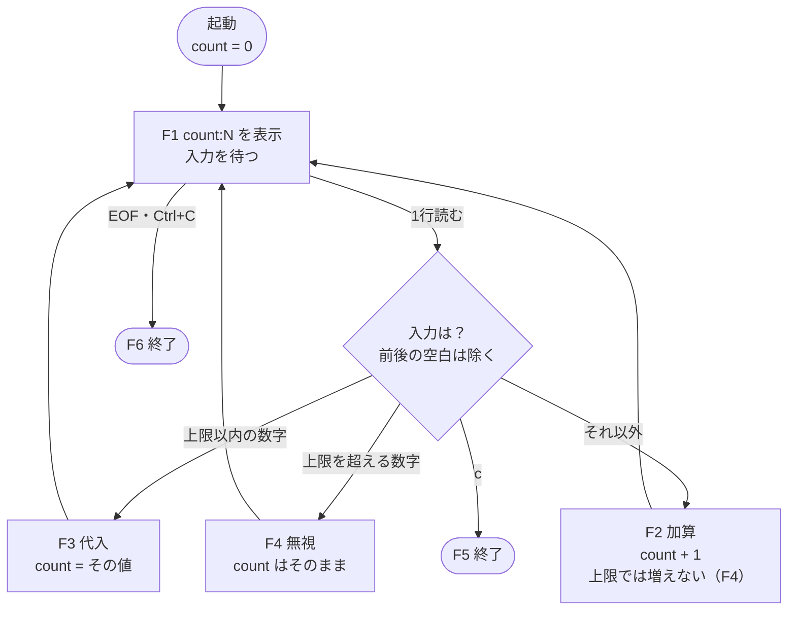

各機能を4実装のどこで実現しているかは、[4章の対応表](#機能と実装の対応表) にまとめています。

### 想定する変更依頼
F1〜F6 は、今のカウンターの仕様です。実際の開発では、仕様は後から変わります。本書では、4章の「試してみよう」などで、次の変更依頼が来た場面を想定します。いずれも、今の4実装には含まれていない機能です。

| ID | 変更依頼 | 求める振る舞い |
| :--- | :--- | :--- |
| R1 | 入力の列から結果を返す | Web などキーボード以外の画面から使えるように、入力の行の列を受け取り、F2〜F5 と同じルールで順に処理したときの最後のカウントを返す関数 `count_from(inputs)` を追加する。表示（F1）は行わず、列の終わりは、入力の終端（F6）と同じく終了として扱う |
| R2 | カウンターを2つ動かす | 2つのカウンターを同時に持ち、互いに影響させずに操作できるようにする |
| R3 | 保存先をデータベースに変える | カウントの値をデータベースに保存し、プログラムを起動し直しても続きから数えられるようにする |

---

## 2. 4象限アーキテクチャ・マトリックス

4つの実装は、「パラダイム（手続き型・オブジェクト指向か、関数型か）」と「設計の規模（軽量・直接的か、多層構造か）」の2軸で、次のように整理できます。

| 規模 ＼ パラダイム | 手続き型 / オブジェクト指向 (OOP) | 関数型プログラミング (FP) |
| :--- | :--- | :--- |
| **軽量・直接的**<br>(Lightweight / Direct) | **第1部 `simple.py`**<br>・表示・入力・計算を1つのループに記述<br>・状態はループの中の変数 `count`<br>・計算を関数にもクラスにも分けない | **第3部 `pythonic_fp.py`**<br>・純粋な状態遷移関数 `step_transition`<br>・`itertools.accumulate` による畳み込み<br>・遅延評価のジェネレータ |
| **多層構造**<br>(Layered / Architectural) | **第2部 `oop/`**<br>・DDD の集約ルートと値オブジェクト<br>・CQRS とイベントソーシング（スナップショット付き）<br>・ヘキサゴナルアーキテクチャと GoF パターン<br>・DI コンテナと実行時間の計測 | **第4部 `monadic_fp/`**<br>・代数的データ型（Action ADT）<br>・`State` / `IO` / `StateIO` / `Option` モナド |

---

## 3. ディレクトリ・階層構造

1ファイルで完結する軽量な設計はリポジトリ直下に、複数レイヤーからなる多層構造の設計は専用ディレクトリに置いています。2章の表の「軽量／多層」の区別が、そのままディレクトリ構成に表れています。

```text
counter/
├── README.md                          # 本ドキュメント
├── HATSUMON.md                        # 発問の手引き (人に教える立場の人向け。本書の問いの設計意図)
├── main.py                            # 実行エントリーポイント (`python counter/main.py`)
├── test_counter.py                    # 単体テストと4実装の契約テスト (`python -m unittest counter/test_counter.py`)
│
├── simple.py                          # 第1部 素朴な手続き型設計 (表示・入力・計算を1つのループに)
│
├── oop/                               # 第2部 オブジェクト指向アーキテクチャ (DDD / CQRS)
│   ├── config.py                      # 設定クラス (Options パターン)
│   ├── domain.py                      # ドメイン層 (集約ルート、値オブジェクト、イベント、例外)
│   ├── repository.py                  # インフラ層 (リポジトリ、イベントバス)
│   ├── pipeline.py                    # CQRS / アプリケーション層 (コマンド、Mediator、ミドルウェア、プロジェクション)
│   ├── presentation.py                # プレゼンテーション層 (入力 Strategy、Host)
│   └── container.py                   # DI コンテナ、サービスファクトリ、run_oop_counter
│
├── pythonic_fp.py                     # 第3部 Pythonic な関数型設計 (ストリーム / itertools.accumulate)
│
└── monadic_fp/                        # 第4部 純粋関数型アーキテクチャ (モナド)
    ├── actions.py                     # 代数的データ型 (Action ADT) とパーサー
    ├── monads.py                      # Option, State, IO, StateIO モナド
    └── runtime.py                     # 状態遷移の合成、REPL の実行、run_monadic_counter
```

---

## 4. 各設計パターンの詳細解説

本章では、素朴な手続き型、その課題を解決するオブジェクト指向、発想を変えた関数型ストリーム、副作用まで値として扱うモナド、の順に解説します。

### 機能と実装の対応表
1章で定義した機能 F1〜F6 を、4つの実装がそれぞれどこで実現しているかの一覧です。同じ機能が、実装ごとに異なる場所・異なる形で書かれていることに注目してください。

| 機能 | 第1部 `simple.py` | 第2部 `oop/` | 第3部 `pythonic_fp.py` | 第4部 `monadic_fp/` |
| :--- | :--- | :--- | :--- | :--- |
| F1 現在値の表示 | `run_simple_counter` の `print` | ホストがリードモデルから読んで `print` | `run_pythonic_fp_counter` の `print` | `monadic_step` の `print_io` |
| F2 加算 | ループ内の `if` 文の最後の分岐 | `IncrementalFallbackStrategy` → `CounterAggregateRoot.increment` | `step_transition` の `case _` | `IncrementAction` → `action_to_state_computation` |
| F3 代入 | ループ内の `if` 文の数字の分岐 | `NumericAssignmentStrategy` → `CounterAggregateRoot.update_explicit` | `step_transition` → `_parse_count` | `_parse_count` → `AssignAction` |
| F4 上限の維持 | `MAX_COUNT` との比較 | `CountBounds`（＋入口の桁数チェック） | `_parse_count` と `min(…, MAX_COUNT)` | `IgnoreAction` と `min(…, MAX_COUNT)` |
| F5 終了 | `c` でループを `break` | `SessionTerminationStrategy` → `TerminateCounterSessionCommand` | `step_transition` が `None` を返し `takewhile` が止める | `TerminateAction` → `Nothing` |
| F6 入力終端・中断での終了 | `run_simple_counter` の `except` | ホストが終了コマンドに読み替え（終了イベントも記録） | `stdin_lines` の `except` | `read_line_io` が `"c"` に読み替え |

---

### 第1部 素朴な手続き型設計（`counter/simple.py`）

第1部の実装 `simple.py` は、次のコードがすべてです。1章の外部仕様（機能 F1〜F6）をすべて満たしており、契約テストにも合格しています。

```python
"""
第1部: 素朴な手続き型設計 (KISS / YAGNI)
表示・入力・計算を、関数にもクラスにも分けずに、1つの while ループの中に書いた最も単純なカウンター。
"""

# カウントの上限 (2^63 - 1)。これを超える代入・加算は無視する
MAX_COUNT: int = 2**63 - 1


def run_simple_counter(initial_count: int = 0) -> None:
    """表示 → 入力 → 計算 を、1つの while ループで繰り返す (main.py から呼び出す入口)"""
    count = initial_count
    while True:
        print(f"count:{count}")
        try:
            query = input().strip()
        except (KeyboardInterrupt, EOFError):
            break
        if query == "c":
            break
        elif query.isdecimal():
            digits = query.lstrip("0") or "0"  # ゼロ埋めは許容する
            # 桁数を先に見て、巨大な数字列を int に変換しない (4300 桁超は ValueError)
            if len(digits) <= len(str(MAX_COUNT)) and int(digits) <= MAX_COUNT:
                count = int(digits)
        elif count < MAX_COUNT:
            count += 1
```

> **問い**：正しく動くのであれば、この単純な作りのままで十分ではないか？

**考えてみよう**：解説を読む前に、「十分」「不十分」のどちらかを選び、その理由を1行で書き留めてください。

**試してみよう**：1章の変更依頼 R1 が来たとします。入力の列を受け取り、F2〜F5 と同じルールで処理したときの最後の値を返す関数 `count_from(inputs)` を追加します（例：`count_from(["", "", "50", "c"])` は `50`）。上のコードを別のファイル（たとえば `my_simple.py`）に写し、`count_from` を書き足してみてください。書き始める前に、元のコードのうち何行くらいを書き換えたり写したりすることになるかを、予想してください。

<details>
<summary>結果（予想してから開いてください）</summary>

たとえば、次のようになります。

```python
def count_from(inputs, initial_count=0):
    count = initial_count
    for raw in inputs:
        query = raw.strip()
        if query == "c":
            break
        elif query.isdecimal():
            digits = query.lstrip("0") or "0"
            if len(digits) <= len(str(MAX_COUNT)) and int(digits) <= MAX_COUNT:
                count = int(digits)
        elif count < MAX_COUNT:
            count += 1
    return count
```

元のループにある計算（終了の判定・代入・加算）の行を、ほぼそのまま写すことになりました。なぜ、元のコードの計算を呼び出して使うことができなかったのでしょうか。次の「コードを読んでみよう」で確かめてください。

</details>

**コードを読んでみよう**：冒頭に示した `simple.py` のコードを、自分の書いた `count_from` と見比べながら読み直し、次の問いの答えを探してください。
* 元のコードで、計算（終了の判定・代入・加算）は、何と同じ場所に書かれているか。
* 入力の受け取り方を `input()` から別の方法に変えるには、どの行からどの行までを書き換える必要があったか。
* 計算のルール（たとえば上限 `MAX_COUNT` の扱い）が変わったら、今は何か所を直すことになるか。

<details>
<summary>答え合わせ（コードの中で探してから開いてください）</summary>

元のコードでは、計算が `while` ループの中に、表示（`print`）や入力（`input`）と混ざって書かれています。計算だけを取り出した関数がないため、外から呼び出すことができず、計算の行を新しい関数に写すしかありませんでした。入力の受け取り方を変えるという画面（入出力）側の変更が、計算のコードにまで及んだのです。

その結果、同じ計算のルールが、`run_simple_counter` と `count_from` の2か所に書かれることになりました。上限などの規則が変われば、2か所とも直す必要があります。変更が来るたびに、変更の範囲は広がっていきます。

最初に選んだ答えは変わりましたか。「正しく動く」ことと「変更に耐える」ことは、別の性質です。

</details>

#### 設計の狙いと構造
* **設計思想**: 素朴な手続き型設計（KISS / YAGNI / Stop Writing Classes）
* **位置づけ**: すべての出発点です。仕様を満たす最小のコードであり、他の3実装と比べるための基準になります。

最も単純な設計です。カウンター程度の機能であれば、関数やクラスに分けること自体が過剰設計である、という考え方に基づき、表示・入力・計算のすべてを1つの `while` ループの中に書いています。
* **状態**: ループの中の変数 `count` に、現在値を保持します。
* **ループ（`run_simple_counter`）**: 表示 → 入力 → 計算（終了の判定・代入・加算）を、1つの `while` ループで繰り返します。`main.py` から呼び出すための入口として、この関数だけがあります。

図にすると、表示・入力・計算・状態が1つのループの中に絡み合っていることが分かります。入出力を少し変えるだけでも、計算を含むループ全体が変更範囲に入ります。これが、後で述べる代償の原因です。

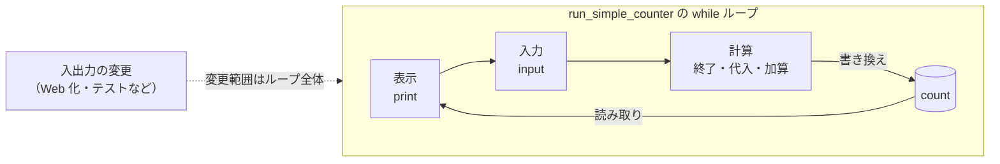

#### 強みと代償
* **強み**: 今後仕様が変わらない使い捨てのスクリプトであれば、これが最善の設計です。コード量はごくわずかで、上から順に読めば動きのすべてが分かります。
* **代償**: 表示・入力・計算・状態が1つのループに絡み合っているため、どれか1つを変えるだけでも、ループ全体が変更範囲に入ります。計算だけをテストする、Web API から利用する、カウンターを2つ動かす、保存先をデータベースにする、といった要求が加わると、ループ全体を書き直す必要があります。

---

### 第2部 オブジェクト指向アーキテクチャ（`counter/oop/`）

> **問い**：画面を変える、カウンターを2つ動かす、保存先をデータベースに変える。こうした変更が来ても、計算のルールを書き換えずに済ませるには、どう作ればよいか？

**考えてみよう**：第1部では、変更依頼 R1（`count_from`）に応えるだけで、計算のルールを写すことになり、同じルールが2か所に書かれました。R2・R3 のような変更でも、同じことが起きそうです。どう作っておけば、こうした変更が計算のルールにまで及ばずに済むでしょうか。解説を読む前に、自分の案を書き留めてください。

**試してみよう**：第1部と同じ変更依頼 R1（`count_from(inputs)`）を、`oop/` を使って実現したものが次のコードです。第1部で書いた `count_from` と見比べてください。コメントにある「係」の中身は、まだ知らなくてかまいません。`counter/` フォルダで実行する前に、次の2つを予想してください。
1. 表示される値は何か。
2. 第1部の `count_from` には、計算のルール（終了の判定・代入・加算・上限）の行がありました。このコードでは、計算のルールはどこにあるか。また、このコードを書くために、`oop/` の既存のファイルを何行書き換えたか。

```python
from oop.config import CounterConfigurationOptions
from oop.container import ServiceContainerFactory
from oop.domain import CounterId, DomainException
from oop.pipeline import CommandMediator, CommandResult, ICounterReadModelProjection, InitializeCounterCommand
from oop.presentation import InputRejectedException, InputStrategyRegistry


def count_from(inputs, initial_count=0):
    # oop/ の部品を組み立て、次の3つの係を受け取る
    container = ServiceContainerFactory.create_default_container(CounterConfigurationOptions())
    parser = container.resolve(InputStrategyRegistry)       # 入力の文字列を「命令」に変える係
    mediator = container.resolve(CommandMediator)           # 命令を実行する係
    views = container.resolve(ICounterReadModelProjection)  # 現在の値を答える係

    counter = CounterId()  # このカウンターを表す ID
    mediator.dispatch(InitializeCounterCommand(counter, initial_count))
    for raw in inputs:
        try:
            if mediator.dispatch(parser.parse(raw, counter)) is CommandResult.TERMINATE:
                break
        except (InputRejectedException, DomainException):
            continue  # ルールにより拒否された入力 (上限を超える数字など) は無視する
    return views.get_view(counter).current_count


print(count_from(["", "", "50", "c"]))
```

<details>
<summary>結果（予想してから開いてください）</summary>

表示されるのは `50` で、第1部の `count_from` と同じ結果です。しかし、このコードには、終了の判定・代入・加算・上限の行が1行もありません。また、このコードを書くために、`oop/` の既存のファイルは1行も書き換えていません。では、計算のルールはどこにあるのでしょうか。次の「コードを読んでみよう」で確かめてください。

</details>

**コードを読んでみよう**：ここで初めて `oop/` のコードを開いてください。ファイルが多いので、まずは次の問いに関係する部分だけを読みます。
1. `presentation.py` の `InputStrategyRegistry` と3つの Strategy：入力の文字列は、それぞれどの命令（コマンド）に変わるか。
2. `domain.py` の `CounterAggregateRoot` と `CountBounds`：代入・加算と上限のルールは、どこに書かれているか。
3. `domain.py` の import：`oop/` のほかのファイル（画面や保存先）を import しているか。

全体の流れは、この後の「設計の狙いと構造」のシーケンス図で確かめられます。

<details>
<summary>答え合わせ（コードの中で探してから開いてください）</summary>

入力の解釈（何が終了で、何が代入か）は `presentation.py` の Strategy が、値の計算と上限のルールは `domain.py` の `CounterAggregateRoot` と `CountBounds` が受け持っています。`count_from` は、それらを呼び出しているだけです。計算のルールは1か所にしかないので、写す必要がなく、ルールが変わっても直す場所は1つで済みます。`count_from` が自分で書いているのは、「ルールにより拒否された入力は無視する」という入出力側の扱いだけで、何を拒否するか（上限など）は `domain.py` が決めています。キーボード版の `CounterApplicationHost` も、同じ扱いをしています。

また、`domain.py` は `oop/` のほかのファイルを1つも import していません。計算のルールは、入力がキーボードから来るのか、`count_from` の引数から来るのかを知らずに書かれています。だから、入出力の側を変えても、計算のルールには及ばないのです。

問いにあったほかの変更依頼も考えてみましょう。R2（カウンターを2つ動かす）は、`CounterId()` を2つ作れば、それぞれが別のカウンターとして動きます。R3（保存先をデータベースに変える）で、どのファイルを書き換え、どのファイルを書き換えずに済むかは、5章 5.1 ④の「依存の向き」の図で確かめてください。

</details>

#### 設計の狙いと構造
* **設計思想**: オブジェクト指向アーキテクチャ（DDD / CQRS / イベントソーシング / ヘキサゴナルアーキテクチャ）
* **位置づけ**: `simple.py` の代償（変更に弱いこと、状態の管理に秩序がないこと）を解決する、代表的な発展形です。

カウンターという小さな題材に、大規模な業務システムで用いられる設計手法（堅牢性・監査性・疎結合性を高める手法）を一通り適用した実装です。意図的に過剰な設計にしてあり、各手法の役割を小さな題材で確認できます。

**静的な構造（クラス図）**: 層と層は `<<interface>>`（抽象ポート）を介してつながっています。ドメイン層（`CounterAggregateRoot` と値オブジェクト）からは、外側への矢印が1本も出ていません。

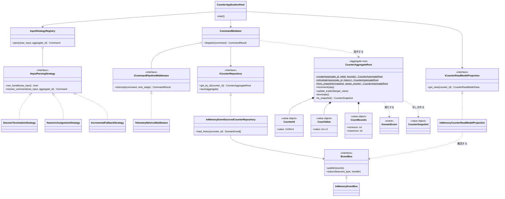

**1回の入力の流れ（シーケンス図）**: Enter を1回押したときの、書き込みパス（1〜14。途中の 12〜13 でイベントがリードモデルに届く）と、読み取りパス（15〜17）です。

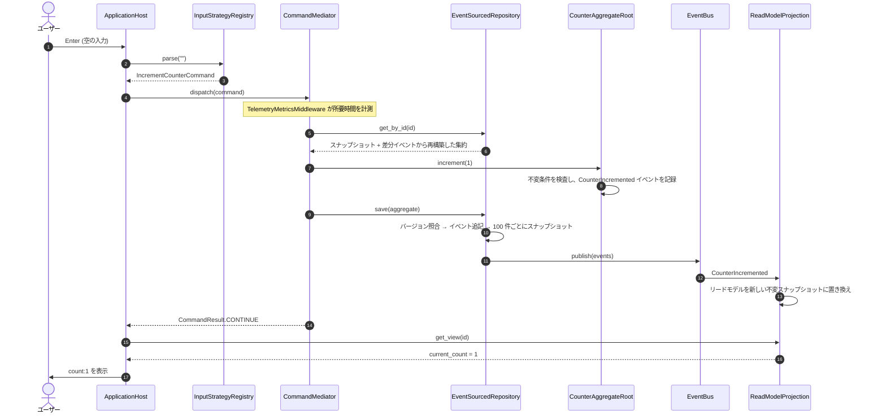

コードを通して読みたい場合は、このシーケンス図の順に `presentation.py` → `pipeline.py` → `domain.py` → `repository.py` → `container.py` とたどると迷いません。

#### 各コンポーネントの役割
1. **ドメイン層（`domain.py`）**
   - **`CounterAggregateRoot`（集約ルート）**: 整合性を保つ単位となるエンティティです。内部状態を直接書き換えず、確定した事実を表すイベントを発行・適用することで状態を変えます（イベントソーシング）。全イベントを再生する `rehydrate` や、スナップショット以降の差分だけを再生する `from_snapshot` によって、同じ状態を再構築できます。初期化前や終了後の操作は拒否します。
   - **`CountValue` / `CounterId` / `CountBounds`（値オブジェクト）**: 生の整数や文字列の代わりに使い、生成時に不変条件（カウント値は 0 以上、ID は UUIDv4、許容範囲は 0〜2^63-1）を検査します。
   - **`DomainEvent` 群**: 過去に確定した事実（初期化、加算、代入、終了）を表す不変の記録です。
2. **インフラ層（`repository.py`）**
   - **`ICounterRepository` / `InMemoryEventSourcedCounterRepository`**: 永続化の抽象（ポート）と、その実装（アダプター）です。集約オブジェクトそのものではなくイベント列を保存し、読み込みのたびに再生して集約を再構築します。
     - **スナップショット**: 全履歴の再生にかかる時間は履歴の長さに比例するため、一定件数（既定 100 件）ごとに状態の写しを保存し、それ以降の差分だけを再生します。
     - **楽観的同時実行制御**: 保存時にバージョンを照合し、古い状態に基づく上書き（ロストアップデート）を `ConcurrencyConflictException` で拒否します。
   - **`InMemoryEventBus`**: ドメインイベントを同期的に配信する仕組みです。保存と同時に、未コミットのイベントが購読者へ配信されます。
3. **CQRS とアプリケーション層（`pipeline.py`）**
   - **CQRS**: 状態を変更する書き込み（Command）と、表示のための読み取り（Query）を分離します。
   - **`CommandMediator`**: コマンドを受け取り、ミドルウェアを経由して処理を振り分けます（Mediator パターン）。
   - **`TelemetryMetricsMiddleware`**: コマンドの実行時間をナノ秒単位で計測するミドルウェアです（Chain of Responsibility パターン）。
   - **`CounterReadModelView`（マテリアライズド・ビュー）**: イベントを購読して更新される、表示用の読み取りモデルです。不変なスナップショットとして返すため、受け取った側が書き換えることはできません。
4. **プレゼンテーション層（`presentation.py`）**
   - **`InputStrategyRegistry`（Strategy パターン）**: `c`、数字、それ以外という入力の種類ごとに、コマンドへの変換方法を切り替えます。上限の桁数を超える数字列は、`int` に変換する前に入口で拒否します（`InputRejectedException`）。
   - **`CounterApplicationHost`**: 起動から終了までと、対話ループを管理します。依存するオブジェクトはすべてコンストラクタで受け取ります。ルールに反する入力は警告ログを出して状態を変えずに続行し、EOF や Ctrl+C も終了イベントとして記録します。
5. **DI コンテナ（`container.py`）**
   - `DependencyInjectionContainer` に「型と生成方法」を登録しておき、最初に `resolve` したときに依存関係を辿ってオブジェクトを組み立てます（以後は同じインスタンスを返します）。
6. **設定（`config.py`）**
   - 初期値・増分・許容範囲・スナップショット間隔などを、不変の設定オブジェクトにまとめて管理します（Options パターン）。

#### 強みと代償
* **強み**: `simple.py` の弱点だった「変更の影響が全体に及ぶ」問題を、層の境界を設けることで解決しています。依存性逆転の原則（DIP）により、画面が Web API や GUI に変わっても、保存先が PostgreSQL に変わっても、`domain.py` の計算ロジックは変更せずに済みます。
* **代償**: オブジェクト指向が抱え続ける「可変な状態」の問題です。
  1. **カプセル化しても、状態が変わること自体はなくならない**:
     状態をオブジェクトの内部に隠しても、時間とともに中身が変わるという性質は残ります。メソッドの結果は引数だけでは決まらず、それまでにどのメソッドがどの順で呼ばれたかに依存します。
  2. **参照の共有による予期しない書き換え**:
     オブジェクトへの参照を複数の箇所で共有すると、別の場所で値が書き換えられる、テストの実行順によって結果が変わる、といった再現しにくい不具合の原因になります。
  3. **並行処理での競合**:
     2つのスレッドが同じカウンターを同時に読み込んで `increment()` すると、片方の更新が失われる（ロストアップデート）おそれがあります。本実装はバージョン照合（楽観的同時実行制御）で後から保存した側を拒否しますが、拒否された側の再試行を設計する必要があります。ロック（排他制御）を使えば、デッドロックや性能低下という別の問題が生じます。可変な状態を共有する限り、この種の問題は避けられません。
  4. **構造を維持するためのコスト**:
     DDD やクリーンアーキテクチャの設計が大きくなりやすいのは、可変な状態を安全に扱うために、集約、値オブジェクト、整合性の境界、トランザクションといった仕組みを重ねる必要があるからです。それらの規約とコードを維持するコストを払い続けることになります。

---

### 第3部 Pythonic な関数型設計（`counter/pythonic_fp.py`）

> **問い**：数を数えるのに、変数を書き換えずに済ませることはできるか？ できるとしたら、何が得られるか？

**考えてみよう**：まず前半の問いに「できる」「できない」で答え、その理由を書き留めてから、解説に進んでください。

**試してみよう**：次を実行し、2回の `print` の結果を予想してください。

```python
from pythonic_fp import counter_stream

inputs = ["", "", "50", "", "c"]
print(list(counter_stream(inputs)))
print(list(counter_stream(inputs)))
```

<details>
<summary>結果（予想してから開いてください）</summary>

どちらも `[0, 1, 2, 50, 51]` です。カウンターの値の列が得られ、同じ入力を与えると、何度呼んでも同じ結果になりました。このとき、どこかで変数は書き換えられているのでしょうか。次の「コードを読んでみよう」で確かめてください。

</details>

**コードを読んでみよう**：ここで初めて `pythonic_fp.py` を開き（100行ほどです）、次の問いの答えをコードの中から探してください。
* `step_transition` は何を受け取り、何を返すか。変数を書き換えている行はあるか。
* `counter_stream` の中で、`itertools.accumulate` と `itertools.takewhile` は、それぞれ何をしているか。
* `run_pythonic_fp_counter` に、値を覚えておいて書き換える変数はあるか。

docstring の中の `>>>` で始まる例は、テストで実際に動かして検証されています。

<details>
<summary>答え合わせ（コードの中で探してから開いてください）</summary>

変数を書き換えている行はありません。`step_transition` は、「今の値と入力」から「次の値」を返すだけの関数です。`itertools.accumulate` がこの関数を（終了後は何もしない `_reduce` で包んだうえで）入力の列に順に適用して値の列を作り、`itertools.takewhile` が終了（`None`）の手前で列を打ち切ります。`run_pythonic_fp_counter` は、流れてくる値を `for` 文で1つずつ受け取って表示するだけで、値を覚えておいて書き換える変数はありません。同じ入力からは必ず同じ列ができ、途中経過もすべて得られます。

`simple.py` で同じ列を得るには、何が必要でしょうか。値は `print` で画面に表示されるだけなので、列としてプログラムで受け取るには、ループそのものを書き換える必要があります。

</details>

#### 設計の狙いと構造
* **設計思想**: 不変性（Immutability）、ストリーム処理、Functional Core / Imperative Shell
* **位置づけ**: オブジェクト指向とは異なる発想に立ち、別の種類の利点を得るアプローチです。

オブジェクト指向は、可変な状態を安全に扱うために多くの仕組み（集約ルート、値オブジェクト、ロック、トランザクション）を用意しました。関数型プログラミングは、そもそも変数を書き換えなければ、それらの仕組みの多くが不要になる、と考えます。

この実装では `while` ループも変数の再代入も使わず、時間の経過を「変数の書き換え」ではなく「値が流れるストリーム」として表現します。

1. **状態遷移の純粋関数（`step_transition`）**
   - `(現在の状態, 入力) -> 次の状態（終了時は None）`
   - 副作用がなく参照透過で、同じ引数には必ず同じ結果を返します。
2. **ストリーム変換パイプライン（`counter_stream`）**
   - `itertools.accumulate` で入力ストリームを順に畳み込みます（関数型言語の `scanl` に相当）。
   - `'c'` の入力で `None` が現れた時点で、`itertools.takewhile` がストリームを打ち切ります。
   - 入力は必要になった時点で1つずつ読まれます（遅延評価）。そのため「表示してから入力を読む」という順序も自然に保たれます。
3. **実行部（`run_pythonic_fp_counter`）**
   - 標準入力を `stdin_lines()` ジェネレータとして供給し、流れてくる各状態を表示するだけの外殻（Shell）です。現在値を保持する変数もありません。

入力も状態も「時間とともに流れてくる値の列」として扱うため、書き換えられる変数がどこにもありません。

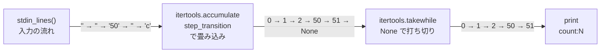

```python
from pythonic_fp import counter_stream, step_transition

# 入力の列から、状態の列を生成する
inputs = ["", "", "50", "", "c"]
assert list(counter_stream(inputs, initial_count=0)) == [0, 1, 2, 50, 51]
```

#### 強みと代償
* **強み**: 変数の再代入をなくしたことで、書き換えによる競合が起こらず、入力の列を与えるだけで途中経過も最終結果も計算・検証できます。イベントソーシングのような仕組みを用意しなくても、ストリームそのものが状態の履歴になります。
* **代償**: ユーザーと対話しながら1ステップずつ進む入出力ループと結びつけるには、ジェネレータによるパイプラインという、一段抽象的な考え方が必要です。

---

### 第4部 純粋関数型アーキテクチャ（`counter/monadic_fp/`）

> **問い**：`print()` や `input()` を含む処理は、同じ引数で呼べば必ず同じ結果になるか？ ならないとしたら、どう扱えばよいか？

**考えてみよう**：たとえば `input()` を2回呼んだとき、同じ文字列が返ってくるでしょうか。まず前半の問いに答えてから、解説に進んでください。

**試してみよう**：次を実行し、`hello` が表示される回数とタイミングを予想してください。

```python
from monadic_fp.monads import print_io

recipe = print_io("hello")
print("--- 組み立て完了 ---")
recipe.unsafe_run_sync()
recipe.unsafe_run_sync()
```

<details>
<summary>結果（予想してから開いてください）</summary>

`--- 組み立て完了 ---` の後に、`hello` が2回表示されます。`print_io("hello")` を呼んだ時点では、何も表示されませんでした。では、`print_io` は何を返しているのでしょうか。次の「コードを読んでみよう」で確かめてください。

</details>

**コードを読んでみよう**：ここで初めて `monadic_fp/` のコードを、次の順に開いてください。
1. `monads.py` の `print_io` と `IO`：`print_io` は何を返しているか。実際に `print` が実行されるのはどこか。
2. `actions.py`：入力の意味（`Action`）は何種類あるか。上限を超える数字の入力は、どれになるか。
3. `runtime.py` の `monadic_step`：`map` と `flat_map` は、それぞれどこで使われているか。`if` 文や `while` ループはあるか。

全体の構造は、この後の「構成要素」のクラス図で確かめられます。`monads.py` の冒頭には、Python とモナドの関係についての解説もあります。

<details>
<summary>答え合わせ（コードの中で探してから開いてください）</summary>

`print_io("hello")` は、`print` を呼ぶ関数を包んだ `IO` の値（`_Delay`）を返すだけで、その場では何も実行しません。`print` が実際に呼ばれるのは、`unsafe_run_sync()` がその手順を実行したときです。同じ手順は何度でも実行できるので、`hello` は2回表示されました。

`print()` や `input()` は、呼ぶたびに外部（画面やキーボード）とやり取りするため、同じ引数でも同じ結果になるとは限りません。そこで第4部では、副作用そのものではなく「副作用を起こす手順」を値として扱い、組み立てと実行を分けています。`monadic_step` に `if` 文も `while` ループもないのは、終了の判断も次のステップへの進行も、この手順の組み立てとして表しているからです。

</details>

#### 設計の狙いと構造
* **設計思想**: 圏論（Category Theory）、代数的データ型（ADT）、モナドによる状態遷移と副作用の表現
* **位置づけ**: 関数型の考え方をさらに進め、副作用まで値として扱う設計です。

Haskell や Scala（cats-effect など）で使われる関数型プログラミングの手法を、Python で再現した実装です。プログラムを「命令の並び」ではなく、「値として組み立てた計算の手順」として記述します。

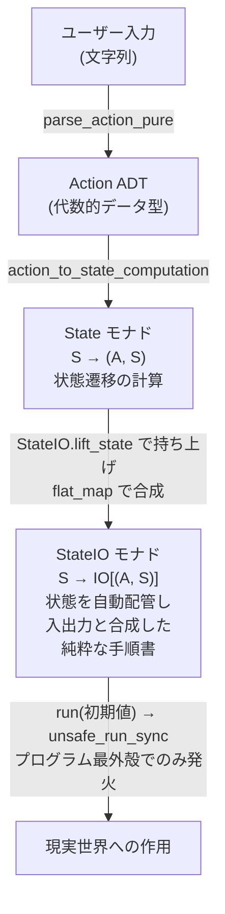

#### 構成要素
1. **代数的データ型（`actions.py`）**
   - 入力の意味を、直和型（Sum Type）の `Action`（`TerminateAction | AssignAction | IncrementAction | IgnoreAction`）として定義します。上限を超える数値の入力はパースの時点で `IgnoreAction` になるため、`AssignAction` は常に有効な値だけを持ちます。
   - 取りうる値を型で限定し、パターンマッチングですべての場合を処理していることを型チェッカーで検証できます。
2. **モナド（`monads.py`）**
   - **`Option[T]`**: 値がある（`Some`）か、ない（`Nothing`）かを表します。値がない場合の扱いを型で明示することで、`AttributeError: 'NoneType' ...` のような None の扱い漏れを防ぎます。このカウンターでは、`'c'` による終了を `Nothing` で表しています。
   - **`State[S, A]`**: 「状態 `S` を受け取り、結果 `A` と新しい状態 `S` を返す関数 `S -> (A, S)`」を表します。状態の更新を関数の合成（`flat_map`）で表現します。
   - **`IO[A]`**: 画面表示や入力といった副作用をすぐには実行せず、後で実行する手順として値の中に保持します。
   - **`StateIO[S, A]`**: State を IO と組み合わせたモナド（Haskell の `StateT s IO a`）です。「状態 `S` を受け取り、副作用の手順 `IO[(A, S)]` を返す関数」を表し、副作用をまたいでも新しい状態を次の計算へ自動的に渡します。
   - **スタック安全な IO**: Python には末尾呼び出し最適化がないため、`flat_map` を素朴に再帰的に実行すると、すぐに再帰の上限（既定 1000）に達して `RecursionError` になります。そこで `IO` を手順の木構造として組み立て、`unsafe_run_sync` が継続を明示的なスタックに積んで反復的に評価する方式（トランポリン）にしています。何万回入力してもスタックはあふれません。
3. **計算の合成と実行（`runtime.py`）**
   - **`monadic_step`**: 画面表示 → 入力 → ADT への変換 → State の計算 → 次のステップ、をすべて `StateIO` の `flat_map` で合成した1つの式として定義します。現在のカウントは引数で渡さず、`StateIO` がステップをまたいで受け渡します。
   - **`unsafe_run_sync`**: プログラムの最も外側（`run_monadic_counter`）で一度だけ呼び出し、組み立てた手順を実行します。副作用が起きるのはこの時点だけです。

**代数的データ型とモナドの構造（クラス図）**: `Action`・`Option`・`IO` はいずれも「このうちのどれか」を表す直和型です。なお `Action` は Python では基底クラスではなく Union 型ですが、図では直和型の構成を継承の矢印で表しています。

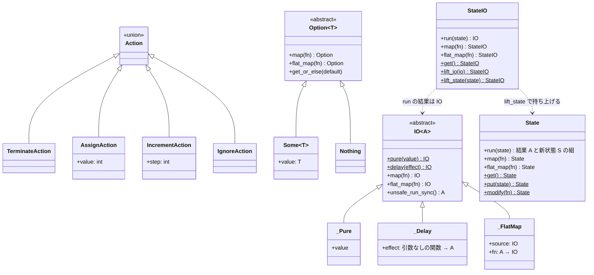

#### 強みと代償
* **強み**: 入出力（副作用）を後で実行する手順として値の中に閉じ込め、`flat_map` によって一本の流れとして合成できます。終了（`'c'`）は `if` 文ではなく `Nothing` によって後続の処理を打ち切る形で表され、プログラム全体が「何度組み立てても同じ手順になる」参照透過な値になります。
* **代償**: 読みやすさです。抽象度が高いため、コードが何をしているかを直感的に読み取ることが難しくなります。
  特に Python には、Haskell の do 記法や Rust の `?` 演算子のような構文も、モナドを型で表す仕組み（高カインド型）も、標準のモナドライブラリもありません。そのため `lambda` を連ねた `flat_map` の連鎖として書くことになり、モナド自体もすべて自作しています（詳しくは `monads.py` 冒頭の「Python とモナド」）。

---

## 5. 初学者のためのアーキテクチャとモナドの入門

### 5.1 なぜファイルを層に分けるのか（第2部 `oop/`）

#### ① すべてを1ファイルに書くことの問題
カウンター程度の規模であれば、1ファイルに書くのが最も自然です。しかし、銀行の振替や EC サイトの決済のような大規模なシステムで、画面・入力・計算・保存を1ファイルに混在させると、次のような問題が起きます。
- 画面のデザインを変えただけで、計算ロジックが壊れる
- データベースを変えたら、画面が動かなくなる
- テストのたびに、本物の画面とデータベースを用意しなければならない

第1部の `simple.py` は、この混在を小さな規模で示しています。これを防ぐために、責務ごとにコードを分けます（関心の分離、Separation of Concerns）。

次の図の左は、すべてが互いに依存し合っている状態です。右は、責務ごとに分けて、依存の向きを計算（ビジネスルール）にそろえた状態です。

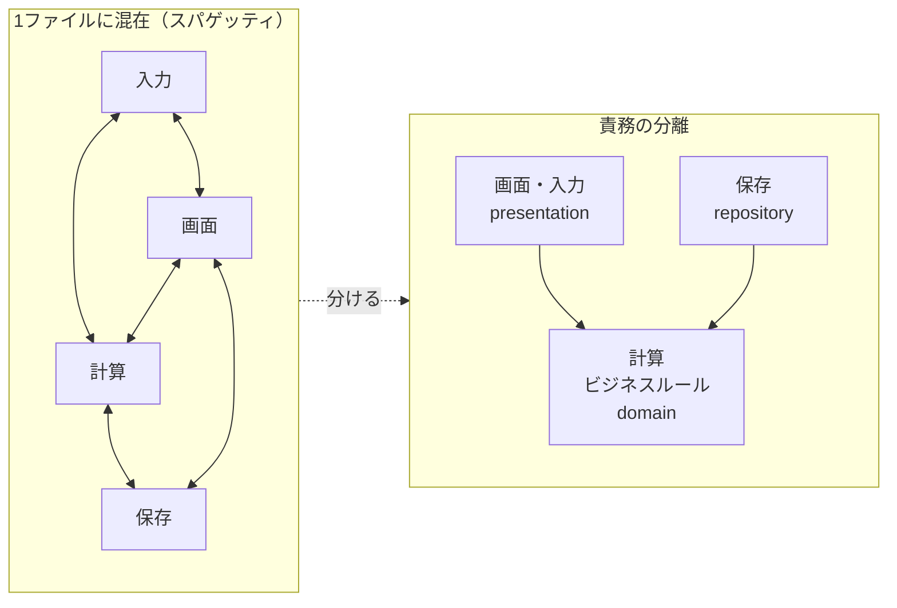

#### ② 各ファイルの役割（レストランのたとえ）
`oop/` の各ファイルの役割は、レストランの分業にたとえることができます。

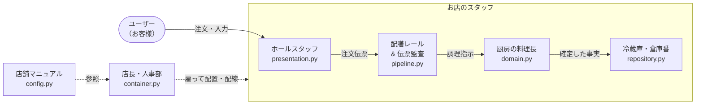

矢印は仕事の流れを表します。「誰が誰を知っているか」という依存の向きは、④で説明します。

| 役割（たとえ） | ファイル | 担当 |
| :--- | :--- | :--- |
| ホールスタッフ（接客係） | `presentation.py` | 画面の描画とキーボード入力を担当する。料理の作り方は知らない。長すぎる数字の注文は、厨房に回す前に入口で断る |
| 配膳レールと伝票の監査 | `pipeline.py` | 注文伝票を受け取り、所要時間をナノ秒単位で計測してログに残す |
| 厨房の料理長（ビジネスルールの中心） | `domain.py` | 「カウントは 0 以上・上限以下」「加算とはどういう計算か」というルールを守る。画面がコンソールか Web か、保存先がどこかは気にしない |
| 冷蔵庫・倉庫番（インフラ層） | `repository.py` | 確定した事実（イベント）を棚に記録し、取り出す。一定件数ごとに棚卸し（スナップショット）をして、取り出しを速く保つ |
| 店舗マニュアル | `config.py` | 1回の増分や上限値などの設定 |
| 店長・人事部 | `container.py` | スタッフ全員を雇い、適切に配置してつなぐ |

#### ③ 層に分けることの利点
1. **画面を交換できる**: `presentation.py` を FastAPI やスマートフォンの UI に差し替えても、`domain.py` は変更不要です。
2. **保存先を交換できる**: メモリから PostgreSQL や DynamoDB に移行するときも、新しいリポジトリ（`ICounterRepository` の実装）を追加し、`container.py` の配線を差し替えるだけで済みます。`domain.py` は変更不要です。
3. **テストが速く、安定する**: `domain.py` は画面もデータベースも必要としないため、単体テストを数ミリ秒で実行できます。

点線の枠は、まだ実装していない差し替え候補です。どれに差し替えても、中央の `domain.py` は変わりません。

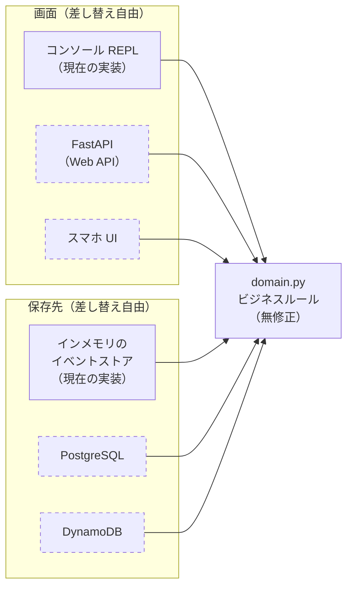

#### ④ 依存の向き（依存性逆転の原則）
この設計で最も重要なのは、「誰が誰を知っているか（依存しているか）」という矢印の向きです。

次の図の矢印は、実際のコードの `import`（＝知っている相手）の向きです。すべての矢印は最終的に `domain.py` へ向かい、`domain.py` から出る矢印はありません。

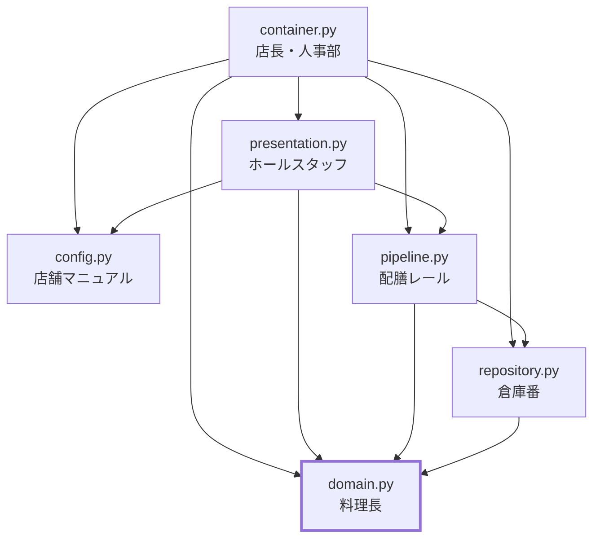

* ホールスタッフ（画面）や倉庫番（データベース）は料理長（ドメイン）を知っていますが、料理長は外側の誰のことも知りません。
* `domain.py` は、コンソールで動いているのか Web ブラウザから使われているのか、保存先が SQLite なのか PostgreSQL なのかを知らずに作られています。
* そのため、Web フレームワークやインフラを変更しても、最も重要なビジネスルールを書き換える必要がありません。

---

### 5.2 モナド（Monad）とは何か

#### ① モナドの考え方
> モナドとは、「文脈」（失敗の可能性、状態、副作用など）が付いた値を、決まった方法で次の処理へ受け渡していくための、統一的な計算の枠組みです。

よく「箱（コンテナ）」にたとえられますが、より正確には「値に文脈を添えたまま、計算同士をつなぐ仕組み」です。
* `Option`：値に「失敗するかもしれない・値がないかもしれない」という文脈を添えます。
* `State`：値に「状態を受け渡していく」という文脈を添えます。
* `IO`：値に「外部に副作用（画面出力・入力）を起こす手順である」という文脈を添えます。
* `StateIO`：`State` と `IO` の文脈を重ねて添えます（状態を受け渡しながら、副作用の手順を組み立てます）。

どの文脈でも形は同じで、「値と文脈」を `flat_map` で順につないでいきます。失敗したら止める、状態を渡す、副作用を順に起こす、といった文脈の扱いは `flat_map` が受け持ちます。

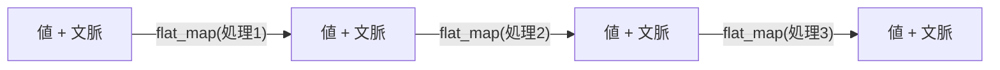

#### ② 4つのモナド

| モナド | 表している文脈 | イメージ |
| :--- | :--- | :--- |
| **`Option[T]`** | 値があるかもしれないし、ない（終了）かもしれない | 中身が入っているかもしれない箱 |
| **`State[S, A]`** | 状態 S を引き継ぎながら結果 A を計算する | 現在の状態を受け取り、次の状態を返す計算の設計図 |
| **`IO[A]`** | 画面出力やキーボード入力という副作用を伴う手順 | すぐには実行しない、副作用の手順書（レシピ） |
| **`StateIO[S, A]`** | 状態 S を引き継ぎながら、副作用を伴う手順を組み立てる | 状態を自動で次へ渡しながら組み立てる手順書 |

##### 1. `Option` モナド
Python でよく見る不具合の1つが `AttributeError: 'NoneType' object has no attribute ...` です。`Option` は、中身がある状態（`Some(値)`）と空の状態（`Nothing`）を同じ型として扱います。
- **特徴**: 中身があるときだけ処理を適用し、空（`Nothing`）のときは何もせずにそのまま返します。

##### 2. `State` モナド
関数型プログラミングでは、`self.count += 1` のような再代入（破壊的変更）を避けます。
- **特徴**: 「現在の値 `s` を受け取り、（結果, 次の値）の組を返す関数」をモナドとして表し、`flat_map` でつないでいきます。

##### 3. `IO` モナド
`print()` や `input()` は、外部（画面やキーボード）とやり取りする副作用です。
- **特徴**: その場で画面に出力するのではなく、「画面に出力する」という手順を `IO` の値として保持します。プログラム本体は手順を組み立てるだけで副作用を起こさず、最も外側（`run_monadic_counter`）で `unsafe_run_sync()` を呼んだときに初めて実行されます。

##### 4. `StateIO` モナド
`State` だけでは副作用を扱えず、`IO` だけでは状態を受け渡せません。カウンターの対話ループは「カウントを保持したまま、画面に出力し、入力を読む」ため、両方が必要です。
- **特徴**: 「状態を受け取り、（結果, 新しい状態）を生む副作用の手順を返す関数」を表します。`flat_map` でつなぐと、副作用をまたいでも新しい状態が次の計算へ自動的に渡されます。純粋な `State` の計算は `lift_state`、状態に関係しない `IO` は `lift_io` で `StateIO` に変換して合成します。

##### `IO` と `StateIO` は「組み立て」と「実行」の2段階で動く
①の段階では何度呼び出しても副作用は起きず、②の `unsafe_run_sync()` で初めて画面とキーボードを使います。

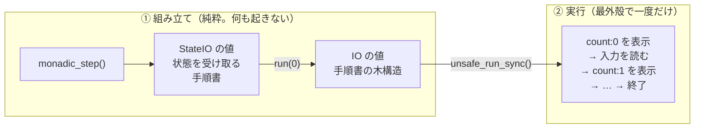

#### ③ `map` と `flat_map` の違い

どちらも「箱（モナド）の中身に関数を適用する」操作ですが、**渡す関数が何を返すか** が違います。

| 操作 | 渡す関数の形 | 関数が返すもの | できること |
| :--- | :--- | :--- | :--- |
| **`map`** | `A -> B` | ただの値 | 箱の中身を変換するだけ（`Some` は `Some` のまま） |
| **`flat_map`** | `A -> M[B]` | 新しい箱 | 次にどうなるかを関数が決められる（停止・副作用・状態の変化） |

```python
Some(5).map(lambda x: x + 1)              # Some(6)
Some(5).map(lambda x: Some(x + 1))        # Some(Some(6))  ← 箱が入れ子になる
Some(5).flat_map(lambda x: Some(x + 1))   # Some(6)        ← 入れ子を平ら (flat) にしてつなぐ
Some(5).flat_map(lambda x: Nothing())     # Nothing()      ← 途中で「失敗」に切り替えられる
```

図にすると次の通りです。

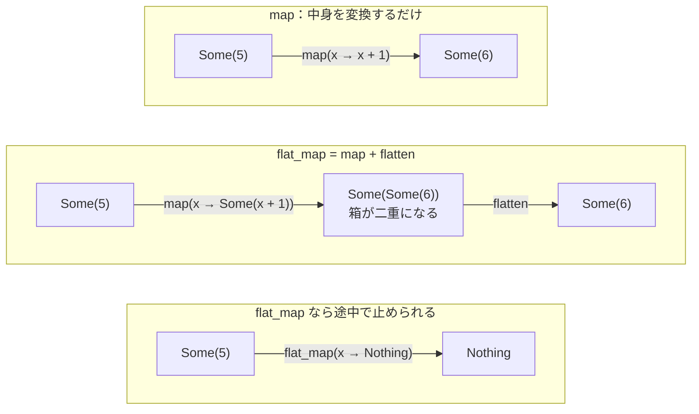

`map` では `Some` を `Nothing` に変えることはできません。途中で止める、新しい副作用を起こす、状態を変える、といった流れの分岐ができるのは `flat_map` だけです。

##### `flat_map` = `map` + `flatten`
`flat_map` は、「`map` した結果、二重になった箱を一重に平らにする（`flatten`）」操作です。二重になった箱をどのように一重にまとめるかが、モナドごとの性質の違いになります。

| モナド | 二重の箱 | `flatten` でのまとめ方 |
| :--- | :--- | :--- |
| `Option` | `Some(Nothing())` | どちらかが空なら空にする（＝途中で止まる） |
| リスト | `[[1, 10], [2, 20]]` | 中身をすべてつなげる（`[1, 10, 2, 20]`） |
| `IO` | 「手順書を返す手順書」 | 外側を実行し、得られた内側の手順書も続けて実行する（＝副作用を順番につなぐ） |
| `State` | 「State の計算を返す State の計算」 | 外側で得られた新しい状態を、内側の計算にそのまま渡す（＝状態の自動的な受け渡し） |

なお、`map` は `flat_map` の特別な場合でもあります。`monads.py` の `IO.map` は、「結果を何もしない箱（`_Pure`）に包んでから `flat_map` する」という1行で定義されています。

##### このカウンターでの使い分け（`runtime.py` の `monadic_step`）
* `.map(parse_action_pure)`：文字列を `Action` に変換するだけの純粋な処理 → **`map`**
* `.flat_map(lambda _: StateIO.lift_io(read_line_io()))`：入力を読むという新しい副作用を起こす → **`flat_map`**
* `.flat_map(lambda outcome: ...)`：次のステップへ進むか、終了するかを選ぶ → **`flat_map`**

##### 言語ごとの呼び名

| 言語 / ライブラリ | `map` | `flat_map` | `flatten` |
| :--- | :--- | :--- | :--- |
| 本リポジトリ | `map` | `flat_map` | （なし。`flat_map(lambda inner: inner)` で書ける） |
| Haskell | `fmap` | `>>=`（bind） | `join` |
| Scala | `map` | `flatMap` | `flatten` |
| Rust | `map` | `and_then`（`Option` / `Result`）、`flat_map`（`Iterator`） | `flatten` |
| Python `returns` | `map` | `bind` | `flatten`（`returns.converters`） |

#### ④ `flat_map` の利点

モナドで中心的な役割を果たすのは `flat_map`（関数型言語では `bind` や `>>=` と呼ばれる操作）です。`flat_map` を使うと、エラー処理と状態管理という2つの典型的な課題を簡潔に扱えます。

##### 利点1：if 文の入れ子を解消する（鉄道指向プログラミング）
手続き型のコードで、失敗する可能性のある処理を順につなぐと、if 文が入れ子になっていきます（Pyramid of Doom と呼ばれます）。

```python
# 通常のコード: if 文が入れ子になり、本来の処理の流れが見えにくい
user = find_user(user_id)
if user is not None:
    order = find_order(user)
    if order is not None:
        payment = process_payment(order)
        if payment is not None:
            send_receipt(payment)
        else:
            print("決済失敗")
    else:
        print("注文なし")
else:
    print("ユーザーなし")
```

`Option` と `flat_map` を使うと、次のように書けます。

```python
# flat_map を使ったコード: 鉄道指向プログラミング
find_user(user_id) \
    .flat_map(find_order) \
    .flat_map(process_payment) \
    .map(send_receipt)
```

2本のレールで表すと、`Some` のまま進む正常系のレールと、`Nothing` になったら最後まで何もせずに進む失敗のレールになります。

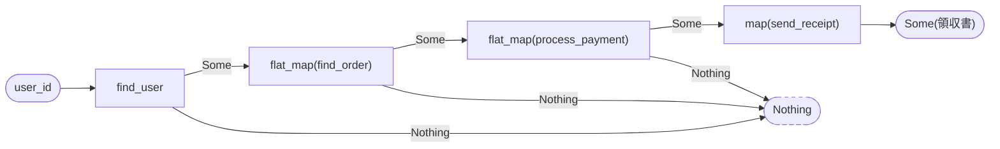

* **失敗の経路が自動で扱われる**: `find_user` の時点で `Nothing`（失敗・不在）になると、それ以降の `find_order` や `process_payment` は実行されず、最後に `Nothing` が返ります。
* **正常系だけを書けばよい**: `if x is not None:` という確認を毎回書く必要がなく、失敗の扱いは `flat_map` が受け持ちます。
* **このカウンターでの使い方**: `'c'` が入力されて `TerminateAction` になると、計算は `Nothing` を返します。`flat_map` でつながった後続の処理は、`if line == 'c': break` のような分岐を書かなくても、そこで終わります。

##### 利点2：状態の受け渡しを自動化する（State モナド）
状態を引き継ぐ処理を素朴に書くと、関数の引数と戻り値で状態を順に受け渡すコードが必要になります。
* `State` の `flat_map` は、前の計算が出した新しい状態 `S'` を、次の計算の入力として自動的に渡します。
* そのため、状態を受け取って渡すためのコードを書く必要がなくなり、計算の中身に集中できます。
* **このカウンターでの使い方**: State を IO と組み合わせた `StateIO` を使うことで、画面出力やキーボード入力をまたいでも、現在のカウントを `monadic_step(count)` のような引数で渡さずに次のステップへ受け渡しています。

入力が `''`、`'50'`、`'c'` の場合の流れは次の通りです。

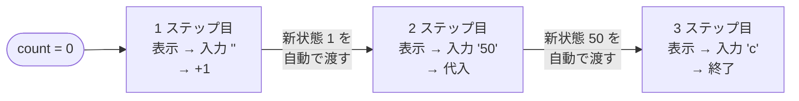

---

## 6. 4つの実装に共通する本質

ここまで、考え方も構造も大きく異なる4つの実装を見てきました。最後に、次の問いを考えます。

> なぜこれほど考え方の異なるコードが、すべて同じカウンターとして正しく動作するのか？

**考えてみよう**：答えを読む前に、4つの実装に共通しているものは何かを考えてください。ヒントは、4章の「機能と実装の対応表」です。

<details>
<summary>答え（考えてから開いてください）</summary>

4つの実装は、どれも **同じ1つの式を計算している** から、同じカウンターとして動作します。6.1 以降で、その式と、4つの実装の違いを説明します。

なお、この「同じ」は比喩ではありません。`test_counter.py` の契約テスト `TestUnifiedContract` が、機能 F1〜F6 ごとのシナリオを4実装に流し、標準出力と入力の読み取り回数が仕様どおりに一致することを自動で検証しています。

</details>

### 6.1 4つの実装に共通するもの

```text
count[0] = 0
count[n] = δ(count[n-1], 入力[n])
```

`δ`（デルタ）は「今の数」と「入力」から「次の数」を決める **状態遷移関数** で、中身は1章で定義した機能 F2〜F5 そのものです（F5: `c` なら終了、F3: 上限以内の数字なら代入、F2: それ以外なら +1、F4: 上限を超えない）。1章の[機能の図](#4実装が守る共通の外部仕様)は、この `δ` を処理の流れとして描いたものです。
つまりカウンターとは、最初の 0 に、入力が届くたびに `δ` を1回ずつ適用し続けるものです。

入力 `''` → `''` → `'50'` → `''` → `'c'` を与えると、4実装すべてが次の同じ列をたどります。

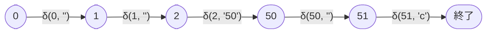

このように、初期値に列の要素を1つずつ関数で組み合わせていく計算を、**畳み込み（fold / scan）** と呼びます。

### 6.2 実装による違い

式が同じなら、4つの実装は何が違うのでしょうか。

**考えてみよう**：4章の各部を思い出して違いを挙げてから、次の表を見てください。

違いは、この式を **どのように実装したか** の3点にまとめられます。

| 実装 | `δ`（遷移の規則）はどこか | 今の数 `count[n]` の置き場所 | ループを回す係 | 副作用（`print` / `input`）の置き場所 |
| :--- | :--- | :--- | :--- | :--- |
| 第1部 `simple.py` | `run_simple_counter` のループ内の `if` 文（関数に分けていない） | ループの中の変数 `count` を上書き | `while True` | ループの中に直接（計算と同じ場所） |
| 第2部 `oop/` | 入力の解釈は Strategy、規則は `CounterAggregateRoot` | 確定した事実（イベント）の列 ＋ スナップショット。表示用にリードモデル | ホストの REPL ループ | プレゼンテーション層に隔離 |
| 第3部 `pythonic_fp.py` | `step_transition()` | どこにも置かない（ストリームを流れる値そのもの） | `itertools.accumulate` | 外殻（`stdin_lines` と `print`）に隔離 |
| 第4部 `monadic_fp/` | `parse_action_pure()` と `action_to_state_computation()` | `StateIO` が裏側で次のステップへ受け渡す | `flat_map` の再帰（トランポリンで実行） | `IO` の値にして、最外殻で一度だけ実行 |

**考えてみよう**：「2^63-1 を超える入力は無視する」（機能 F4）という仕様が、後から追加されたとします。4つの実装のどこを変えれば済むでしょうか。予想してから、4章の対応表の F4 の行と比べてください。

この3つの選択の違いが、1章の問い「ごくわずかなコードで正しく動くプログラムを、なぜわざわざ複雑な設計で書くのか？」への答えになります。式（＝ビジネスルール）が同じでも、状態と副作用をどこに置くかによって、変更や並行処理が加わったときに何が壊れやすく、どのようなコストを払うかが変わるのです。

* **`simple.py`**: 状態・計算・入出力を1つのループに置いたため、どれか1つを変えるだけで、ループ全体が変更範囲に入ります。その代わり、余分なコストはありません。
* **`oop/`**: 状態をイベントの列に置き、副作用を外側の層に分離したため、画面や保存先の変更に強くなりました。その代わり、層と規約を維持するコストがかかります。
* **`pythonic_fp.py`**: 状態を流れる値として扱うため、書き換えによる競合が起こりません。その代わり、対話ループと結びつけるための考え方の転換が必要です。
* **`monadic_fp/`**: 副作用まで値として扱うため、プログラム全体が1つの純粋な式になりました。その代わり、読みやすさを犠牲にしています。

### 6.3 同じ式を見る5つの視点

この式は、見る角度によって、計算機科学のいくつかの概念と結びつきます。さらに学ぶための手がかりとして、関連する学術用語を挙げます。

| 視点 | 式のどこを見るか | 最も直接的に表している実装 | 関連する学術用語 |
| :--- | :--- | :--- | :--- |
| ① 状態機械 | `δ` そのもの | 第1部 ループ内の `if` 文 | 有限状態機械、Moore 機械、余代数 (Coalgebra) |
| ② 畳み込み | 0 に `δ` を順に適用していく流れ全体 | 第3部 `itertools.accumulate` | fold / scan（scanl）、離散時間積分器 |
| ③ 事実の畳み込み | 入力の代わりに「確定した事実」の列を畳み込む | 第2部 イベントソーシング | Event Sourcing、CQRS、マテリアライズド・ビュー |
| ④ 関数の合成 | 入力1つ＝「数を受け取り数を返す関数」と見て、つなぎ合わせる | 第4部 `State` モナド | 自己準同型 (Endomorphism)、モノイド、圏論 |
| ⑤ 数そのもの | `+1` という操作 | すべての実装 | ペアノの公理、後者関数 (Successor Function) |

#### ① 状態機械
「今の状態（現在の数）」と「入力」の組み合わせだけで、次の状態が決まる仕組みです。駅の自動改札機が、入れられた切符によって扉を開けるかどうかを決めるのと同じ構造です。表示する `count:N` は状態だけで決まるため、分類上は **Moore 機械** にあたります。
また、上限 2^63-1 があるため状態の数は有限であり、このカウンターは **有限状態機械** です。1章の機能の図は、この機械の遷移規則を描いたものであり、`simple.py` のループ内の `if` 文は、それを最も直接的にコードにしたものです。

#### ② 畳み込み
入力が1つ届くたびに `δ` を適用し、その時点の値を記録し続けます。最終結果だけを求めるのが **fold**（`functools.reduce`）、途中経過をすべて並べるのが **scan**（`itertools.accumulate`）です。
`pythonic_fp.py` は scan をそのまま使っており、画面に表示される `count:N` の列は scan の結果そのものです。

#### ③ 事実の畳み込み
イベントソーシングでは、今の数を直接保存するのではなく、「+1 した」「50 を代入した」という確定した事実を列として保存します。今の数は、その列を初期値から畳み込むことで、いつでも計算し直せます。家計簿にたとえると、レシートの束（イベント）を順に合計すれば残高（今の数）が分かる、という関係です。
`CounterAggregateRoot.rehydrate` はこの畳み込みそのものです。スナップショットは途中まで畳み込んだ結果の保存、リードモデルは畳み込んだ結果を表示用に保持したものにあたります。

#### ④ 関数の合成
入力1つを「数を受け取り、数を返す関数」に変換してみます（`''` は「+1 する」、`'50'` は「50 にする」）。すると、セッション全体はそれらの関数を順につないだ1つの関数になり、それを 0 に適用すると最後の数が得られます。

```text
「+1 する」→「+1 する」→「50 にする」→「+1 する」 をつないだ関数に 0 を与える → 51
```

「数 → 数」の関数（自己準同型）同士は常に合成でき、何もしない関数（恒等関数）を単位元として **モノイド** をなします。

モノイドに必要なのは、**結合法則**（どこから先にまとめてつないでも結果が同じ）と **単位元** の2つだけで、**交換法則**（順番を入れ替えても結果が同じ）は必要ありません。実際、カウンターの操作は、順番を入れ替えると結果が変わります。

```text
0 に「+1 する」→「50 にする」の順で与える → 50
0 に「50 にする」→「+1 する」の順で与える → 51
```

「+1 する」だけなら順番を入れ替えても結果は変わりませんが、「50 にする」（代入）が加わることで、順番が意味を持つようになります。だからこそ、カウンターは入力を「列」として、順に畳み込む必要があるのです。なお、上限を超える数字の入力（機能 F4 で無視するもの）は、何もしない関数、つまり単位元にあたります。

第4部の `State` モナドと `flat_map` は、この合成を値として組み立てる仕組みです。

#### ⑤ 数そのもの
`+1` は「次の数へ進む」**後者関数** で、ペアノの公理で自然数を定義するときの出発点です。どの実装の `+1` も、この最も基本的な操作を書いたものです（上限 2^63-1 で頭打ちにしている点は、数学の自然数と異なります）。

### まとめ

オブジェクト指向、関数型、モナドは、互いに対立するものではありません。4つの実装はいずれも `count[n] = δ(count[n-1], 入力[n])` という同じ式を計算しており、違うのは状態と副作用をどこに置くかだけです。そして、その置き場所の選び方が、どのような変更に強く、どのようなコストを払うかを決めます。

設計を選ぶとは、この小さな式のまわりにどこまで仕組みを築くかを、システムの寿命と規模に合わせて決めることです。

> **発展課題**: 6.3 に挙げた学術用語を手がかりに、関連する書籍や論文を調べてみてください。日常的なコードが、数学的な概念とどのように結びついているかを確かめられます。

---

## 7. 振り返り

### 7.1 最初の問いに戻る
1章で書き留めた、中心となる問いへの自分の答えを読み返してください。

> ごくわずかなコードで正しく動くプログラムを、なぜわざわざ複雑な設計で書くのか？

**考えてみよう**：
* 今なら、この問いにどう答えますか。最初の答えと比べて、何が変わりましたか。
* 4章の4つの問いのうち、予想が外れたものはどれでしたか。外れたことで、何に気づきましたか。

<details>
<summary>本書としての答え（自分の答えを書いてから開いてください）</summary>

設計の複雑さは、それ自体が目的ではありません。仕様や環境の変更に備えるための仕組みであり、その仕組みにはコストがかかります。変更の予定がなければ `simple.py` が最善であり、変更が予想されるほど、状態と副作用をどこに置くかを考えた設計が効いてきます（6.2）。設計を選ぶとは、どんな変更に備え、どこまでコストを払うかを、システムの寿命と規模に合わせて決めることです。

</details>

### 7.2 問いを自分の設計に持ち帰る
本書では、問いを受け、予想し、試し、解説を読む、という順で読み進めてきました。本書の問いは、実際の開発で設計を選ぶときにも、自分に向ける問いとしてそのまま使えます。

| 自分の設計に向ける問い | もとになった問い |
| :--- | :--- |
| このコードには、どんな変更が来そうか。来ないなら、単純な作りのままで十分ではないか | 第1部 |
| 変更が来たとき、ビジネスルールを書き換えずに済むか。依存の向きは、ビジネスルールに向かっているか | 第2部 |
| 状態を書き換える代わりに、値の列や計算の結果として表せないか | 第3部 |
| 副作用（入出力・通信・保存など）を、どこに閉じ込めているか | 第4部 |
| その設計のために、どれだけのコストを払っているか。それは、備えたい変更に見合っているか | 1章・6章 |

**考えてみよう**：最近書いたコードを1つ思い浮かべ、上の問いに答えてみてください。

> **補足：本書の問いの作り方について**
> 本書の問いは、教育の分野で「発問」と呼ばれる考え方に基づいて設計しています。勉強会の講師やメンターなど人に教える立場の人や、問いの作り方に関心がある人に向けて、本書の問いの設計意図を [発問の手引き（HATSUMON.md）](HATSUMON.md) にまとめました。本書で設計を学ぶうえでは、読む必要はありません。

---

## 8. 実行方法リファレンス

**動作環境**: Python 3.11 以上（標準ライブラリのみ。外部パッケージのインストールは不要）

コマンドライン引数で、実行する実装を切り替えられます。
**すべての実行モードで、標準出力の振る舞いは [1章の共通仕様](#4実装が守る共通の外部仕様)（機能 F1〜F6）どおりに統一されています。** 起動バナーなどは出さず、`count:0` から入出力を始めます。

```powershell
# 第1部 素朴な手続き型設計 (デフォルト / --simple)
python counter/main.py
python counter/main.py --simple

# 第2部 オブジェクト指向アーキテクチャ (DDD / CQRS / イベントソーシング)
python counter/main.py --oop

# 第3部 Pythonic な関数型設計 (ストリーム処理 / itertools.accumulate)
python counter/main.py --fp

# 第4部 純粋関数型アーキテクチャ (State / IO / StateIO モナド)
python counter/main.py --monad

# 使い方の表示 (フラグは同時に1つだけ指定できます)
python counter/main.py --help
```

`counter/` フォルダの中からは `python main.py --oop` のように実行できます。

#### テストの実行
```powershell
python -m unittest counter/test_counter.py
```

テストスイートは次の3種類で構成されています。

| 種類 | 内容 |
| :--- | :--- |
| 各実装の単体テスト | 4実装それぞれの部品（第1部のループ、集約ルート、`step_transition`、モナドなど）の振る舞い |
| 契約テスト（`TestUnifiedContract`） | 機能 F1〜F6 ごとのシナリオを4実装に流し、標準出力と入力の読み取り回数が仕様どおりであることを検証。すべての機能にシナリオがあることも検証 |
| doctest | `pythonic_fp.py` と `monads.py` のドキュメント中のコード例が、実際にその通り動くことを検証 |
